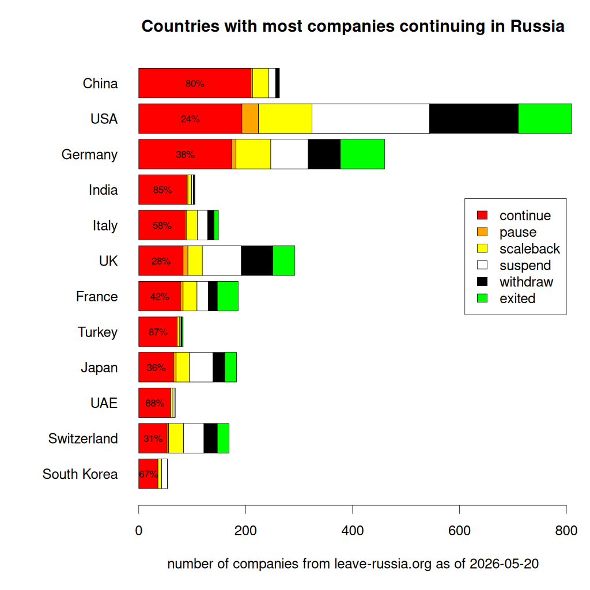

# Business in Russia {#sec-economy-world}

::: {.callout-caution title="Myth"}
Business and politics can be kept separate
:::

::: {.callout-tip title="Truth"}
- Companies that make business with Russia help Russia conduct a bloody war
- Companies that make business in Russia pay blood tax to the evil empire
:::

* Some countries have barely reduced their business operations in Russia (China, India, Turkey, UAE)
* The U.S. has significantly reduced its business operations in Russia, while Germany has reduced them to a much lesser extent

For details on individual countries, see [leave-russia.org](https://leave-russia.org/)
