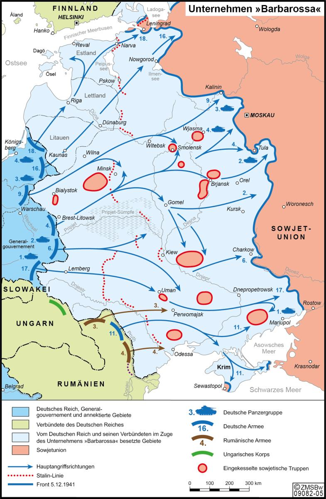
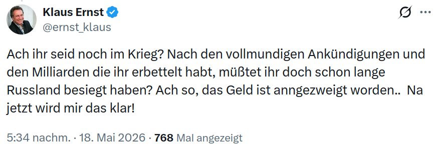

# Deutsch-russische Beziehungen  {#sec-germany-russia}

::: {.callout-caution title="Mythos"}
- Deutschland trägt eine historische Verantwortung gegenüber Russland [{height=1em}](https://euvsdisinfo.eu/disinformation-cases/?text=russian%20german&sort=relevance)
:::

::: {.callout-tip title="Wahrheit"}
- Deutschland hat sich mehrfach mit Russland verschworen, auf Kosten Polens und der Ukraine [{height=1em}](https://de.wikipedia.org/wiki/Deutsch-russische_Beziehungen)
- Deutschland trägt eine historische Verantwortung gegenüber der Ukraine
:::

## Vorsowjetische Zeit

### Wissenstransfer (seit 1480)

> Die russischen Herrscher haben schon immer gern Berater aus Deutschland rekrutiert. Nicht nur Kandidaten für den Gazprom-Aufsichtsrat, auch große Gelehrte, nach denen in Hannover heute goldene Kekse benannt sind, gehören dazu: Gottfried Wilhelm Leibniz (1646 bis 1716), der deutsche Universalgelehrte schlechthin, war Philosoph, Mathematiker, Vordenker der Aufklärung – und außerdem Geheimer Justizrat im Dienste des Zaren.[^germany-russia-25]

Die Moskauer Großfürsten beziehungsweise Zaren Iwan III. und Iwan IV., ließen Handwerker, Militärs und andere Spezialisten wie Ärzte, Apotheker, Gelehrte, Techniker, Waffenschmiede, Kanonengießer, Ingenieure und militärische Instrukteure in Deutschland anwerben. In Moskau entstand so im 16. Jahrhundert eine Ausländersiedlung, die „Deutsche Vorstadt“. 

Auf Leibniz folgten weitere namhafte Mathematiker wie Daniel Bernoulli und Leonard Euler.[^germany-russia-26] Mit keinen anderen westeuropäischen Ausländern hatten Russen seit dem 18. Jahrhundert so zahlreiche und vielfältige Verbindungen wie mit Deutschen. Ab 1698 begann an der Universität Halle die geregelte Unterrichtung in Russischer Sprache. Bis heute pflegt die Universität Halle besonders enge Beziehungen zu Russland und beherbergt und schützt einen der bekanntesten pro-russischen Professoren Deutschlands, der in schöner Regelmäßigkeit wie John Mearsheimer immer wieder fordert, die Ukrainer müssten dem Frieden zuliebe kapitulieren. 

Seit jeher diente der deutsch-russische Kultur- und Wissenschaftsaustausch als Deckmäntelchen für wirtschaftlich-militärische Zusammenarbeit. So ging das 1921 eingerichtete Büro für ausländische Wissenschaft und Technik (BINT) bei der sowjetischen Handelsvertretung in Berlin mit der geheimen militärischen Zusammenarbeit unter dem Vertrag von Rapallo Hand in Hand, siehe @sec-germany-russia-militarycooperation. Dabei hatte die angeblich "anti-faschistische" Sowjetunion keine Berührungsangst mit faschistischer Theorie und praxis: Im Jahr 1928 wurde ein Russisch-Deutsches Komitee für Rassenforschung gegründet.

### Großer Nordischer Krieg (1700 - 1721)

Im [Großen Nordischen Krieg](https://de.wikipedia.org/wiki/Gro%C3%9Fer_Nordischer_Krieg) (1700 - 1721) stand Preußen vor der Wahl, sich einer Europäischen Allianz gegen Russland anzuschließen oder eine separate Bündnispolitik mit dem Zaren zu betreiben. Der "Soldatenkönig" Friedrich Wilhelm I ließ sich zunächst auf ein Bündnis mit London ein, verriet diese aber und schlug sich auf die Seite Russlands:

> Der Soldatenkönig jedoch unterschrieb den Vertrag nur unter schweren innerlichen Qualen, die ihn sogar aufs Krankenlager warfen, denn er fürchtete den Rückhalt des Zaren zu verlieren, der ihm trotz widersprüchlicher Erfahrungen ein Gefühl der Sicherheit gab. Im inneren Konflikt, den Friedich Wilhelm durchlebte, mischten sich Emotion und Kalkül. Zwischen Russland und Preußen bestand eine Art Wahlverwandtschaft.  
> ...  
> Mit viel Empathie für die Situation des Zaren begründete er seine Entscheidung, aus dem gerade mit England-Hannover geschlossenen Bündnis keine Allianzpolitik gegen den Zaren folgen zu lassen ... Sie basierte auf einer ähnlich feindseligen Wahrnehmung der englisch-hannoverschen Politik (ein Vorläufer des Antiamerikanismus) und hatte eine mächtepolitische Verwurzelung in einem gemeinsamen Interesse an einer dauerhaften Schwächung Polens (bzw. der Ukraine). auf dieser Basis trafen sich der Zar und der Soldatenkönig, als sie im Februar 1720, etwa ein halbes Jahrhundert vor der ersten Teilung Polens, erstmals einen Vertrag unterzeichneten (ähnlich den Verträgen von Rapallo und dem Hitler-Stalin-Pakt), der ein ganzes Bündel anti-polnischer Bestimmungen enthielt ... Friedrich Wilhelm garantierte in einer persönlichen Deklaration, die er selbst vor seinen Ministern geheim hielt, nicht an der Seite Englands in den Krieg gegen Russland einzutreten.[@Schulze_Wessel:2023, S. 41f, unsere Anmerkungen in Klammern]

Ohne preussische (und polnische) Verbündete hatte die Containementpolitik Londons gegen Russland keine Chance.  Ingermanland, Estland, Livland und ein Teil von Finnland gingen in den Besitz Russland über. Russland beherrschte nun die Ostsee und löste Schweden als Hegemonialmacht im Nordosten Europas ab. 

> In der dramatischen Endphase des Nordischen Krieges hatten sich zwei unterschiedliche Muster herausgebildet, auf Russland als neuen europäischen Machtfaktor zu reagieren: englisches Containement und preußische Russlandbindung zur gemeinsamen Beherrschung Polens. In einer bemerkenswerten Pfadabhängigkeit griffen London und Berlin bis zum ersten Weltkrieg immer wieder auf diese Muster zurück. Die britischen Politik betrieb antirussisches Containement vor allem in der orientalischen Frage, so im letzten Viertel des 18. Jahrhunderts und dann im Krimkrieg, sowie in der Konkurrenz mit Russland in Zentralasien ... Umgekehrt folgte die preussische Politik bis zur Reichsgründung 1870/71 fast durchgehend einem Primat der Russlandbidung, wobei die Kontrolle Polens den zweck des russisch-preussischen Bündnisses bildete.
[@Schulze_Wessel:2023, S. 42].

Dieses verräterische Muster prägte die Kollusion zwischen Deutschland und Russland für Jahrhunderte, erlaubte ein unerhörtes Wachstum des russischen Imperiums, und setzte sich im Verhältnis zur Sowjetunion fort.

### Auswanderung nach Russland (seit 1762)

Zeitweilig erschien manchen Deutschen Russland als das Gelobte Land, sie wanderten aus und unterstützten mit ihrer Arbeitskraft den russischen Imperialismus:

> Zehntausende Menschen machten sich 1762 auf eine beschwerliche Reise von den Ufern des Rheins und Neckars an die ferne Wolga: Mit ihren Bibeln und Gesangbüchern folgten sie dem Ruf der Zarin Katharina, sich in Russland niederzulassen und, auf 30 Jahre von Steuern befreit, ein Stück Land zu bewirtschaften. Die Kolonisten machten ihre Sache gut und vermehrten sich prächtig: 1874, bei Einführung der allgemeinen Wehrpflicht in Russland, zählte man bereits mehr als eine Million Russlanddeutsche im Zarenreich.[^germany-russia-33] 

## Sowjetische Zeit

### Ukrainische Volksrepublik

Das Deutsche Kaiserreich spielte ab 1915 eine entscheidende, teils steuernde Rolle in der Russischen Revolution, indem es die Bolschewiki um Lenin unterstützte, um Russland im Ersten Weltkrieg zu schwächen. Deutschland ermöglichte Wladimir Lenin und anderen Revolutionären im April 1917 die Rückkehr aus dem Schweizer Exil nach Russland, um die provisorische Regierung zu stürzen. Der deutsche Geheimdienst und das Auswärtige Amt unterstützten die Bolschewiki finanziell, um Streiks und Propaganda zu fördern:

> Der Zusammenfall der deutschen imperialen Interessen und der Interessen Lenins war im Revolutionsjahr 1917 weder für Freund noch Feind zu übersehen.[^germany-russia-23]

Während Lenin sich 1917 in seinen April-Thesen gegen die Annexionspolitik des - jetzt sowjetischen - Russischen Imperiums (gegenüber Polen, der Ukraine) aussprach,[^germany-russia-24] zerschlug er die 1918 frisch gegründete [Ukrainische Volksrepublik](https://de.wikipedia.org/wiki/Ukrainische_Volksrepublik) und annektierte diese in das sowjet-russische Reich:

> Entgegen ursprünglicher Versprechen war Lenin keineswegs bereit, die Legitimität und Autonomie der Ukrainischen Volksrepublik anzuerkennen und bezeichnete sie als Feind der Revolution. In einem Memorandum im Dezember 1917 stellt der Rat der Volkskommissare der Ukraine ein Ultimatum. Sollte diese die geforderten Maßnahmen nicht innerhalb der nächsten 48 Stunden ergreifen, würde sich die neue revolutionäre Regierung in Russland im Kriegszustand mit der Ukrainischen Volksrepublik befinden. [{height=1em}](https://de.wikipedia.org/wiki/Geschichte_der_Ukraine#20._Jahrhundert_bis_zur_Unabh%C3%A4ngigkeit_1991)  

Der erste Ukrainische Staat wurde im russischen Bürgerkrieg nach dem Einmarsch der Roten Armee Anfang 1920 aufgelöst und als Ukrainische Sozialistische Sowjetrepublik in Sowjetrussland eingegliedert.

### Militärpolitische Zusammenarbeit (1920 - 1933) {#sec-germany-russia-militarycooperation}

16. April 1922 unterzeichneten Deutschland und Russland den Vertrag von Rapallo.[^germany-russia-7] Mit dem Vertrag nahmen die beiden Staaten ihre wirtschaftlichen und diplomatischen Beziehungen wieder auf ... unter großer Skepsis der Westmächte, insbesondere Frankreichs. Das berechtigte Misstrauen gegenüber einer Annäherung Deutschlands an Russland wird bis heute als "Rapallo-Komplex" bezeichnet. Während 1953 noch behauptet wurde, es habe keine geheime Zusatzvereinbarung zum Vertrag von Rapallo gegeben[^germany-russia-12], ist seit spätestens 1961 bekannt, dass am 29. Juli und am 11. August 1922 Deutschland und Russland geheime Abkommen über militärische Zusammenarbeit, gemeinsame militärische Vorbereitungen für einen Krieg gegen Polen begannen.[^germany-russia-2] 

> Die politische Isolierung des Deutschen Reiches und der Sowjetunion, die gemeinsame Frontstellung gegen das neuerstandene Polen, an das beide Staaten nach dem Ersten Weltkrieg bzw. dem polnisch-sowjetischen Krieg bedeutende Gebiete abgeben mußten, die militärischen Restriktionen des Versailler Vertrags auf deutscher Seite und das sowjetische Ziel, eine moderne Armee aufzubauen, waren die ausschlaggebenden Faktoren, die zu der geheimen Zusammenarbeit zwischen der Reichswehr und der Roten Armee zwischen 1920 und 1933 führten. Dieses Thema war in der Sowjetunion zum Tabu erklärt und der offenen wissenschaftlichen Diskussion entzogen worden.[^germany-russia-3]

Das heißt, anders als von deutsch-russischer Seite behauptet, hat Stalin mit dem Molotow-Ribbentrop-Pakt nicht einfach auf Hitler reagiert, ohnehin eine realitätsfremde Behauptung angesichts der Aufteilung Polens, sondern die Deutsch-Sowjetische Zusammenarbeit gegen Polen begann kurz nach Ende des Ersten Weltkriegs, und zwar mit geheimen gemeinsamen Rüstungsprojekten:

> Zur Finanzierung und Koordination der getarnten Rüstungsunternehmen in der UdSSR, die auch deutsche Aufträge für militärische Güter ausführten, gründete das Reichswehrministerium 1923 die „Gesellschaft zur Förderung gewerblicher Unternehmungen" (Gefu) mit Sitz in Berlin und Moskau und stellte ihr das nötige Betriebskapital zur Verfügung. Mit der Leitung der Gefu wurde Major a. D. Fritz Tschunke beauftragt. Unter ihrer Obhut standen die Flugzeugfabrik in Fili, die Chemiefabrik Bersol' für die Produktion von Giftstoffen in Ivascenkovo bei Samara mit Beteiligung der Firma Stoltzenberg und die Produktion von Artilleriemunition in verschiedenen sowjetischen Fabriken (Zlatoust, Tula, Ochta, Kazan', Petrograd) mit Hilfe von Krupp. Damals schlugen in Rußland auch BMW (Panzer- und Flugzeugmotoren), Karl Walter (Schußwaffen), Rheinmetall, Siemens, Carl Zeiss und andere Firmen Wurzeln.^[ebenda]

> Obwohl die militärische Zusammenarbeit zwischen der Sowjetunion und Deutschland zwischen 1922 und 1933 oft vergessen wird, hatte sie einen entscheidenden Einfluss auf die Ursprünge und den Ausbruch des Zweiten Weltkriegs. Deutschland baute sein zerstörtes Militär in vier geheimen Stützpunkten in Russland wieder auf. Im Gegenzug entsandte die Reichswehr Männer, um das junge sowjetische Offizierskorps auszubilden und zu trainieren. Der wichtigste Aspekt der sowjetisch-deutschen Zusammenarbeit war jedoch ihre technologische Komponente.[^germany-russia-4]

### Hitler-Stalin (1939-1941)

Dass Hitler und Stalin gemeinsam Verantwortung für den Zweiten Weltkrieg tragen, wird gerne geleugnet[^germany-russia-1] (@sec-wwii-responsibility):

> Der Molotow-Ribbentrop-Pakt, der am 23. August 1939 unterzeichnet wurde, war der Höhepunkt eines zwei Jahrzehnte währenden Kreuzzugs beider Seiten, sich zu bewaffnen, die in Versailles geschaffene Nachkriegsordnung zu beseitigen und ihren gemeinsamen Feind Polen zu vernichten. Die Wiederaufnahme der militärischen Zusammenarbeit spielte eine entscheidende Rolle bei der Reformierung des Bündnisses zwischen den Weltkriegen.^[ebenda]

Die Kollaboration reichte bis zur Angleichung der nationalistisch bis chauvinistisch ausgerichteten Kultur- und Medienkanäle, aus denen das Wort „Faschismus“ verschwand. Sergej Eisenstein inszenierte Wagner am Bolschoi-Theater, die Bibliotheken der UdSSR wurden gesäubert, antifaschistische Werke von Thomas und Heinrich Mann oder Franz Werfel (und sogar diejenigen kommunistischer Autoren wie Willi Bredel, Hans Marchwitza und Erich Weinert) verschwanden genauso wie die Emigrantenzeitungen.[^germany-russia-1]

> Auch die Umsetzung in der Erinnerungs- und Kulturpolitik und der politischen Bildungsarbeit verlief bis heute nur schleppend. Von interessierter Seite gesteuerte Lügen- und Propagandaerzählungen, Relativierungen oder schlichtes Ableugnen trugen dazu bei, dass man in der Geschichtsforschung von einem umfassenden Verständnis des „Teufelspaktes“ noch weit entfernt ist. Legitimatorische Erzählungen sind weiter en vogue.^[ebenda]

### Unternehmen Barbarossa (1941-1945)

Am 22. Juni 1941 marschierte die deutsche Wehrmacht in die Sowjetunion ein. Mit dem "Unternehmen Barbarossa" begann ein machtpolitisch, wirtschaftlich und rassenideologisch motivierter Vernichtungskrieg.

> Auf Weisung Hitlers traf die Wehrmacht ab Dezember 1940 konkrete Vorbereitungen für einen Krieg gegen die Sowjetunion. Vorgesehen war, einen Großteil der dortigen Bevölkerung zu töten, einen kleinen Teil zu "germanisieren" – und den Rest zu versklaven oder zu vertreiben. Hierdurch sollte der "Lebensraum im Osten" für die Ansiedlung von Deutschen entstehen. Dasselbe Motiv hatte bereits dem Krieg gegen Polen zugrunde gelegen ... So koordinierte die "Wirtschaftsorganisation Ost" bzw. der "Wirtschaftsstab Ost" in den besetzen Gebieten die massenhafte Ausbeutung von Rohstoffen und die Verschleppung von Interner Link: Zwangsarbeiterinnen und Zwangsarbeitern.[^germany-russia-13]

Sind die deutschen Panzer nach Russland gerollt? Nein. Ein Blick auf die Karte zeigt, Russland-Feldzug hieß zuerst: baltische Staaten, Belarus und vor allem: Ukraine.

[{width="67%"}](https://zms.bundeswehr.de/de/mediathek/aktuelle-karte-barbarossa-5386466)

> Ende 1941 waren das Baltikum, Weißrußland sowie große Teile der Ukraine besetzt. In den eroberten Gebieten begannen Einsatzgruppen mit ihren mörderischen "Sonderaufgaben": die systematische Ermordung jüdischer Einwohner, kommunistischer Funktionäre sowie der Sinti und Roma. Bis Ende 1941 fielen den Massenerschießungen, an denen sich auch Einheiten der Wehrmacht beteiligten, rund eine halbe Million Menschen zum Opfer. Die anfängliche Freude der einheimischen, vor allem ukrainischen und baltischen Bevölkerung über die Befreiung vom "stalinistischen Joch" durch die Wehrmacht schlug mehrheitlich in Hass um, aus dem sich ein von beiden Seiten mit äußerster Brutalität geführter Partisanenkrieg entwickelte.[^germany-russia-15]

Hitler wollte die nährstoffreichen Schwarzen Böden und die Rohstoffe der Ukraine, und er wollte "Ostarbeiter", und er wollte Juden töten.[^germany-russia-14] Und die lebten vor allem in der Ukraine. 

## DDR im kalten Krieg

Nur zwei Jahre nach Ende des Zweiten Weltkriegs gründete sich im Juni 1947 die „Gesellschaft zum Studium der Kultur der Sowjetunion“, die auf dem 2. Kongress im Juli 1949 in „Gesellschaft für Deutsch-Sowjetische Freundschaft“ (DSF) umbenannt wurde. Die wirtschaftlichen und kulturellen Kontakte zwischen den „Bruderländern“ Deutschland und Russland galten als vorbildlich innerhalb des Ostblocks. Bis 1990 schlossen rund 12.000 Studenten ihr Studium in der Sowjetunion ab ... die Elite der DDR wurde systematisch auf russische Linie gebracht.

## BRD im kalten Krieg

### Adenauer (1949 - 1953)

Die erste selbständige außenpolitische Handlung der souveränen Bundesrepublik war Adenauer's Reise am 8. September 1955 nach Moskau: im Glauben, deutsche Kriegsgefangene aus russischen Lagern zu befreien, tat Adenauer genau was Chruschtschow von ihm wollte ([Reflexive Kontrolle](#sec-intro-termstech-reflexivecontrol)): die Sowjetunion bekam diplomatische Anerkennung - trotz der Deutschen Teilung - und damit den Einstieg in wirtschaftliche (Korruption) und kulturelle (Indoktrination) Beziehungen: 1958 wurde im Weltsaal des Auswärtigen Amts in Bonn das erste Handelsabkommen zwischen der Bundesrepublik und der Sowjetunion unterzeichnet.[^germany-russia-16] [^germany-russia-17]

### Ehrhard (1953 - 1966)

Während der Kanzlerschaft Erhards waren die Beziehungen zwischen Deutschland und der Sowjetunion zurückhaltend. Allerdings stürzte Ludwig Erhard 1966 über eine Note, die er "Deutsche Vorschläge für eine konstruktive Friedenspolitik" nannte und in der er der Sowjetunion und allen Ostblockstaaten den Austausch förmlicher Gewaltverzichtserklärungen, Abrüstung und Entspannung anbot - eine Aufweichung der [Hallstein-Doktrin](https://de.wikipedia.org/wiki/Hallstein-Doktrin) und Vorwegnahme der Brandt'schen Ostpolitik.[^germany-russia-18]

Von 1959 bis 1964 wird die Druschba-Pipeline von Tartastan in die DDR gebaut. 

### Kiesinger (1966 - 1969)

Georg Kiesinger wiederholt bei seinem Amtsantritt das Angebot Erhards und behauptet - in Verkennung der geschichtlichen Tatsachen - Deutschland sei jahrhundertelang die Brücke zwischen West- und Osteuropa gewesen. Auch mit Polen und der Tschechoslowakei wolle sich das deutsche Volk verständigen.[^germany-russia-19] Davon blieb nach dem [Prager Frühling](https://de.wikipedia.org/wiki/Prager_Fr%C3%BChling) wenig übrig. Während der kurzen Kanzlerschaft Kiesingers wurden wichtige Weichen in Richtung Entspannung (Appeasement) gegenüber der Sowjetunion gestellt, deren tiefere Gründe im Verhalten der USA und Frankreichts lagen, deshalb hier aus einem insgesamt sehr lesenwerten Artikel mehrere Passagen mit eindrucksvoller Ähnlichkeit zur russichen Invasionen in die Ukraine:

> Nach Bildung der Großen Koalition im Dezember 1966 war die Bundesregierung bereits so weit, Begründungen zu finden, die es rechtfertigten, zu allen Staaten des Ostblocks (wiederum mit Ausnahme der DDR) sogar volle diplomatische Beziehungen aufzunehmen. Man argumentierte jetzt, daß diese Ostblock-Staaten seit Gründung der DDR im Jahr 1949 zu dieser nur gezwungenermaßen diplomatische Beziehungen unterhalten hatten, und leitete daraus die Berechtigung ab, in solchen Sonderfällen gleichfalls diplomatische Beziehungen aufzunehmen, während man aber gegenüber Nicht-Ostblock-Staaten weiterhin mit großem Nachdruck am Alleinvertretungsanspruch festhielt.  
>  ...  
> Während des ganzen Monats Mai und danach registrierten die westlichen Nachrichtendienste den Truppenaufmarsch rings um die Tschechoslowakei; Ende Mai begann auch eine „Stabsübung" des Warschauer Pakts in der ansonsten von sowjetischen Truppen freien CSSR. Von seiten der NATO kamen allerdings beruhigende Informationen. Die Truppenbewegungen wurden als Teil eines Nervenkriegs interpretiert  
> ...  
> vergleicht man die westliche Reaktion mit früheren oder späteren Reaktionen auf sowjetische Gewaltmaßnahmen, so ist jedoch die Tatsache, daß es nach der Intervention ("Prager Frühling") fast zu keiner offiziellen Erörterung von nachhaltigen Gegenmaßnahmen und von Sanktionen kam, eines der aufschlußreichsten Phänomene dieser Krise, das der Erklärung bedarf ... demonstrative Untätigkeit des Westens ...  Zu fragen bleibt somit generell, wie die insgesamt recht geschäftsmäßige, von Zynismus nicht freie Hinnahme dieser flagranten Verletzung des Völkerrechts erklärbar ist ... wurde vollends deutlich, daß die USA demonstrative Zurückhaltung übten ... Jedenfalls spürte Kiesinger auch aus dem Gespräch mit dem amerikanischen Botschafter heraus, daß die Führungsmacht der NATO entschlossen war, die Vorgänge in der CSSR vorerst so weit wie nur irgend möglich herunterzuspielen. Dies mag wenigstens teilweise seine überdeutliche Zurückhaltung erklären. Befremden erweckte auch der Umstand, daß die Bundesregierung nicht von NATO-Stellen, sondern durch die Nachrichtenagenturen über die Intervention des Ostblocks unterrichtet wurde ... Zudem mußte die Bundesrepublik rasch erkennen, daß die Bemühung um strategisch konkrete Schlußfolgerungen aus der Intervention eher früher als später die Forderung der USA nach verstärkten militärischen und finanziellen Leistungen der europäischen Alliierten zur Folge haben würde  
> ...  
> Bahr fügte noch hinzu: Die Frage, was nun geschehen solle, finde keine Antwort. Zwei Dinge aber habe der Kanzler begriffen: „Die Friedenspolitik muß fortgesetzt werden. Wir wollen und können nur etwas bekommen von den Russen. Sein vorherrschendes Gefühl gegenüber den Russen sei Angst." ... Zweifellos haben alle Beteiligten in Bonn aus den Vorgängen die Lehre gezogen, künftig auch den leisesten Anschein zu vermeiden, differenzierte Entspannungspolitik an der Sowjetunion vorbei betreiben zu wollen ... Vor allem Egon Bahr war es jetzt, der Brandt gegenüber nachdrücklich dafür plädierte, das Gespräch über die zentralen Streitfragen nun wieder in erster Linie mit der Sowjetunion zu führen ... Da sich ohnehin keine Staatengruppe für eine Veränderung des Status quo in Europa einsetze, so Bahr weiter, wäre es jedoch riskant, seitens Bonns den Ländern „Zwischen-Europas" die Priorität zu geben ... Es war auch erkennbar, daß die Regierung Johnson überhaupt nicht daran dachte, sich durch die Prager Vorgänge vom Abschluß des Nichtweiterverbreitungsvertrags abbringen zu lassen ... am weitesten ging dabei Egon Bahr, er äußerte sich in einem internen, für Bundesaußenminister Brandt bestimmten Memorandum am radikalsten: „Die Fiktionen, die wir immer weiter mit uns schleppen, werden von uns und anderen zu einem Strick gedreht, der uns erdrosseln kann. [Artikel] 53 und 107 sind dieselbe Schimäre wie das Fortbestehen Deutschlands als Ganzes.  
> ...  
> im Frühjahr 1969 wurde die Kommunistische Partei der Tschechoslowakei wieder erbarmungslos gleichgeschaltet ... Auch das politische Bonn war schon längst wieder zur Tagesordnung übergegangen. Künftig wurde es hier als eine bleibende Lehre der tschechoslowakischen Krise verstanden, daß man zu Reformkommunisten oder zu offen protestierenden Dissidenten deutliche Distanz zu halten habe. Geboten und erlaubt schien allenfalls die Bitte gegenüber den repressiven Autoritäten um menschliche Behandlung oder Expatriierung im Einzelfall. So hat sich Bonn gegenüber den Unterzeichnern der Charta 77, gegenüber den „Helsinki-Gruppen" in der Sowjetunion und 1980/81 gegenüber „Solidarnösc" verhalten. Auch in dieser Hinsicht wirkte die CSSR-Krise von 1968 als Katalysator für Ängstlichkeiten, die zwar zuvor schon ersichtlich waren, von nun aber verhaltensbestimmend wurden und die Bonner Entspannungspolitik bis in die Jahre des Umbruchs 1989/90 kennzeichneten.[^germany-russia-20]

### Brand (1969-1974)

Unter Willy Brand begannen die Deutsch-sowjetische Röhren-Erdgas-Geschäfte:

> Am 1. Februar 1970 unterschreiben in der Essener Nobeladresse Kaiserhof die Manager von Mannesmann, Ruhrgas AG und Deutscher Bank mit ihren sowjetischen Verhandlungspartnern den Vertrag zu einem einträglichen Milliardengeschäft. Mannesmann liefert den Sowjets Großröhren, die für eine 2.000 Kilometer lange Pipeline reichen. Die Deutsche Bank schießt einen günstig taxierten Kredit von 1,2 Milliarden Mark vor, damit die Käufer die Ware bezahlen können. Im Gegenzug liefert die Sowjetunion 20 Jahre lang bis zu 3 Milliarden Kubikmeter Erdgas im Jahr.  
> ...  
> Brandt sieht – 25 Jahre nach dem Krieg – in den Gaslieferungen aus Sibirien weniger die Gefahr einer Abhängigkeit als einen Vertrauensbeweis gegenüber dem einstigen Todfeind. Einwände der USA werden abgewehrt.[^germany-russia-5]

### Schmidt (1974-1982)

Unter Kanzer Schmidt stiegen die Gasimporte auf 30 Prozent des Verbrauchs:

> Die ansteigenden Gaslieferungen überdauerten schwere Krisen wie den sowjetischen Einmarsch in Afghanistan 1979 und das Ende 1981 in Polen verhängte Kriegsrecht. Die US-Regierung kritisierte erneut den Ausbau des deutsch-sowjetischen Gashandels. Sie verlangte Sanktionen gegen Moskau und eine Abkehr von dieser Abhängigkeit, was die Bundesregierung ablehnte. "Wer Handel miteinander treibt, schießt nicht aufeinander", argumentierte Helmut Schmidt.[^germany-russia-6] 

Die deutsche Sozialdemokratie hat sich beim beginnenden Zusammenbruch der Sowjetunion auf die Seite Moskaus und gegen den Freiheitswillen der russischen Kolonien gestellt:

> Im Jahr 1981 schrieb Egon Bahr, der Architekt der deutschen Ostpolitik, der Frieden sei wichtiger als Polen. Es war, als General Wojciech Jaruzelski das Kriegsrecht verhängte.[^germany-russia-8] [^germany-russia-9] 

> Die Devisen, die für das Deutschland gelieferte Gas nach Moskau flossen, ermöglichten der Sowjetunion, legal und oft illegal westliche Spitzentechnologie zu kaufen, mit denen weitere Gasfelder erschlossen werden konnten.
> ...  
> Die CIA hatte in Erfahrung gebracht, welche besonders wichtigen Steuerungsbauteile die Sowjetunion bei westlichen Partnern illegal kaufte. Statt diese Geschäfte nun aber zu unterbinden, manipulierten US-Experten die gelieferten Programme, vielleicht auch die Schaltungen ... die US-Dienste hätten dafür gesorgt, dass noch im Jahr 1982 mindestens ein wichtiger Pipeline-Knotenpunkt detonierte. Die Explosion sei so groß gewesen, dass man sie aus dem Weltraum habe sehen können. [^germany-russia-22] [^germany-russia-21]

### Kohl (1982-1992)

Ein erheblicher Teil der deutschen Öffentlichkeit hat auf die Stationierung Sowjetischer Mittelstreckenraketen mit Angst und Appeasement reagiert, und die sogenannte "Friedensbewegung" hat -- gesteuert vom KGB -- versucht, die zur Abschreckung nötige Nachrüstung[^germany-russia-27] mit Pershing-Mittelstreckenraketen zu verhindern.[^germany-russia-28]

Als die Sowjetunion das Wettrüsten verlor und Michail Gorbatschow im Dezember 1987 in Washington mit Ronald Reagan ein Abkommen über die Reduzierung von Mittelstreckenraketen in Europa unterzeichnete, brach in Deutschland die "Gorbimanie" aus: die Deutschen verklärten den Führer der Sowjetunion zum Heiligen. Dieser habe Deutschland die Einheit geschenkt (was wohl eher Ronald Reagan zu verdanken war). 

> Einzig in Deutschland wird Michail Gorbatschow zur Lichtgestalt verklärt, auch die Nachrufe ähneln Heiligenerzählungen. Doch das geht meilenweit an der politischen Realität vorbei. Die Wiedervereinigung wollte er eigentlich verhindern, seine Wirtschaftsreformen waren eine Katastrophe – und in Riga, Vilnius, Tiflis und Baku zeigte sich der Friedensnobelpreisträger als brutaler Imperialist.[^germany-russia-32]

Dass Gorbatschow am 13. Januar 1991 -- dem Blutsonntag von Vilnius -- mit Gewalt die Freiheitsbestrebungen der Baltischen Staaten unterdrücken wollte,[^germany-russia-29] [^germany-russia-30] ist bis heute nicht in deutschen Köpfen präsent, deshalb noch 2026 ein Aufklärungsartikel der Bundeswehr[^germany-russia-31]

Während die Gorbimanie schlussendlich eine Gesamtdeutsche Verklärung Russlands war, gab es noch spezifischere pro-russische Aktivitäten: Schlüsselakteure der deutschen Sozialdemokratie versuchten die deutsche Einheit zu sabotieren und Russland die DDR zu retten:

> Bahr habe „nach 1989 alles versucht, um den Zwei-plus-vier-Vertrag zu verhindern ... Bahr konspirierte mit der Gorbatschow feindlich gegenüberstehenden Falin-Gruppe in Moskau“, schreibt Baum in einem Leserbrief in der „FAZ“.  
>  
> „Ich habe es satt, dass wir Sozialdemokraten dauernd sowjetischer sind als die Sowjets“, klagte der SPD-Außenpolitiker Norbert Gansel schon vor 33 Jahren, im Februar 1990, nachdem Bahr verkündet hatte, das vereinigte Deutschland dürfe nicht Mitglied der Nato sein[^germany-russia-10]

## Post-Sowjetische Zeit

### Kohl (1992-1998)

Unter Kohl kamen gut 2,3 Millionen russlanddeutsche (Spät-)Aussiedler aus der ehemaligen Sowjetunion nach Deutschland. Kohl versprach sich dankbare CDU-Wähler. Diese gefährliche Wette -- auf Menschen ohne jede Demokratieerfahrung -- ging zum Teil auf:

> Beide Konstellationen – unauffällige Integration und fortbestehende Segregation – beschreiben die Realität unterschiedlicher Milieus innerhalb der Großgruppe "russlanddeutsche Spätaussiedler".[^germany-russia-34] 

Allerdings blieben 20%-30% -- mehr als eine halbe Million Menschen -- schlecht integriert, konsumieren russische Medien, saugen russische Propaganda auf und wählen heute extremistische pro-russische Parteien. Manche verherrlichen ostalgisch Russland und hoffen auf eine Rückkehr ins gelobte Land, bis hin zum Gutheißen des russischen Angriffskrieges und dem skrupellosen Diebstahl ukrainischer Grundstücke.[^germany-russia-35]

### Schröder (1998-2005)

Unter Schröder fand die Gorbimanie ihre Fortsetzung: in völliger Verkennung von Putins Charakter, Zielen und seinem Hintergrund als Geheimdienstmann und St. Petersburger Mafiosi, bejubelte am 25. September 2001 der Deutsche Bundestag die Rede eines Mannes, der mit fingierten Sprengstoffanschlägen in Moskau einen brutalen Krieg in Tschetschenien rechtfertigte, und sich daran machte, koste es was es wolle, Russland zu alter und neuer Größe zu bomben.[^germany-russia-36] Dass diese Rede in Russland als Rückeroberung Berlins gefeiert wurde, ignorierte man geflissentlich.[^germany-russia-37]

Gerhard Schröder und seine Frau Schröder-Köpf nahmen von Putin eine ganz besondere Gefälligkeit an: sie adoptierten zwei russische Kinder auf dem kurzen Dienstweg -- trotz fortgeschrittenen Alters und dreier gescheiterter Ehen Schröders.[^germany-russia-38]

Unter Schröder wurde die Gegenspionage des BND gegen Russland eingestellt: man verzichtete -- ohne Not -- darauf, Agenten zu identifizieren und zu beobachten, was der russiche Geheimdienst tut.[^germany-russia-39] 

Es wurde "Wandel durch Handel" gelogen, mit den Grünen stieg Schröder aus der Atomkraft aus, und schloß Vorverträge für Nordstream I: 

> Gazprom wird zum verlängerten Arm, zur politischen Waffe Putins, Erpressungen und Drohungen gehören zum normalen Geschäftsgebaren. Auch wenn man in Deutschland damals kaum Notiz davon nimmt: Putin nutzt die Abhängigkeit von russischen Energielieferungen gegenüber anderen Staaten mit aller Brutalität.

### Merkel (2005-2013)

> Am Jahresbeginn 2006 eskaliert der Gasstreit zwischen Russland und der Ukraine. Russland hat neue Tarife für den Gastransit durch die Ukraine diktiert und will für den Eigenverbrauch Kiews „marktorientierte Preise“ durchsetzen. Als die Ukraine sich weigert, die heftigen Aufschläge zu akzeptieren, stoppt Putin die Lieferungen im eiskalten Januar.[^germany-russia-5]

Unter 16 Jahren Merkel wurde so viel für Russland getan, dass hier eine Stichwortliste genügen muss:

* Merkel inszenierte sich zu Beginn Ihrer Karriere als "Klimakanzlerin" bildgewaltig im roten Anorak in der Arktis, praktisch lobbyiierte sie für den Verbrenner, gegen die Verkehrswende, gegen die Energiewende und für russisches Gas ("Brückentechnologie", "Hybridheizungen") [^germany-russia-70]
* die Gegenspionage blieb eingestellt
* die Bundeswehr wurde geschrumpft, kaputtgespart und die Wehrpflicht ausgesetzt
* Die Rede von Putin auf der Münchener Sicherheitskonferenz wurde nicht als das wahrgenommen, was sie war: eine Ansage des aggressiven russischen Imperialismus.[^germany-russia-50]
* Merkel verhinderte 2008 (mit Frankreich) die NATO-Mitgliedschaft der Ukraine
* Merkel unterlief die langfristig vereinbarte Abkehr von der Atomkraft, verlängerte 2010 die Laufzeiten der Atomkraftwerke, und zementierte 2011 die Abhängigkeit von russischem Gas durch den überhasteten Fukushima-Atomausstieg
* Nordstream I wurde gebaut
* 2011 wollte Deutschland (Rheinmetall) der russischen Armee bis 2014 hochmoderne Kampf-Simulator-Zentren bauen, angesichts der Krim-Invasion wurde das 2014 - angeblich rechtzeitig - abgebrochen.[^germany-russia-40] [^germany-russia-41]

## Heißer Krieg

### Altkanzler Schmidt (2014)

Helmut Schmidt, mit der Autorität des "Altkanzlers", erklärt kontrafaktisch, die Ukraine gebe es nicht und Russland wolle keinen Krieg. 

::: {.callout-caution title="Ex-Kanzler Schmidt verteidigt mit der Autorität des 'Altkanzlers' die Krim-Invasion Putins:"}
"Es ist verständlich, dass die Polen sich das wünschen ... Aber Frau Merkel tut gut daran, diesem Ruf nicht zu folgen sondern zurückhaltend zu bleiben, um die Lage nicht zu verschärfen ... Diese Sanktionen bringen nichts und führen bloß zur Forderung nach noch schärferen Sanktionen. Und wenn die nicht wirken, verlangt jemand verstärkte Rüstung. Und dann landen wir am Ende beim Krieg mit Waffen ... die Politik des Westens basiert auf einem großen Irrtum: dass es ein Volk der Ukrainer gäbe, eine nationale Identität. In Wahrheit gibt es die Krim, die Ost- und die West-Ukraine. Die Krim, einst Land der Tataren, kam erst in den 50er Jahren durch ein „Geschenk“ des russischen Staatschefs Chruschtschow zur Ukraine. Die West-Ukraine besteht größtenteils aus ehemaligen polnischen Gebieten, allesamt römisch-katholisch. Und die Ost-Ukraine, überwiegend russisch-orthodox, liegt auf dem Gebiet der Kiewer Rus, dem einstigen Kerngebiet Russlands."[^germany-russia-11]
:::

::: {.callout-tip title="Schmidt verbreitete hier - in der BILD - eine volle Breitseite russischer Propaganda:"}
Kyjiv und die Kyjiver-Rus' und das Slavische Christentum waren nicht russisch, sondern Ukrainisch (@sec-ukraine-kyiv), den Russen gehört überhaupt kein Land natürlich, welches sie sich nicht mit Gewalt angeeignet hätten (@sec-russia-history) und die Krim war alles mögliche, aber nicht russisch, sondern wurde nach und nach russifiziert, samt Genozid an den Krim-Tataren (@sec-crimea-history), genauso wie die ukrainische Sprache und Kultur auf dem Gebiet der Kyjiver Rus' nach und nach mit Gewalt durch russische Sprache (@sec-language-russia, @sec-language-ukraine) ersetzt wurde, eine russische Kultur - außer die der Gewalt - gibt es ohnehin nicht (@sec-culture-russia).
:::

### Merkel (2013-2021)

* Während der Krim-Invasion bedrängte Merkel die Ukrainische Übergangsregierung, sich nicht gegen Russland zu wehren, berichtet der litauische Generalleutnant a. D. Jonas Vytautas Žukas, der von Juli 2014 bis 2019 militärischer Oberbefehlshaber der Litauischen Armee war.[^germany-russia-71]

* Journalisten die kritisch über die Invasion berichten wollten, wurden unter Druck gesetzt.[^germany-russia-78] 

* Vermeintlich kritische - faktisch anti-amerikanische - Kabarettisten unterstützten Russland: den Tiefpunkt deutscher Kabarettkunst bildete eine Sendung der "Die Anstalt", bei der 2014 Max Uthoff und Claus von Wagner unter dem Deckmantel des Pazifismus und zu Diensten des Totalitarismus[^germany-russia-82-de] verbreiteten russische Narrative zur "Verteidugung" der Krim-Invasion.[^germany-russia-79] Der Kabarettist Florian Schroeder diffamiert 2019 Volodymyr Zelenskyy,[^germany-russia-80] und die Kabarettistin Anny Hartmann verharmlost die Erderhitzung und betrieb 2025 Täter-Opfer-Umkehr im russischen Angriffskrieg.[^germany-russia-81]

* Putin erzeugt Flüchtlingswellen aus Syrien und Merkel holt sie ins Land und macht damit die AfD groß

* Trotz Krim-Invasion, MH17 und der Übernahme des Donbas wurde auch Nordstream II gebaut und in russische Gasfelder investiert[^germany-russia-48]

* Die Regierung Merkel erlaubte die Übernahme von Gasleitungen und Speichern durch russische Konzerne und ließ zu, dass Russland die Speicher im Winter 2021/2022 leerlaufen ließ, womit Deutschland (noch) erpressbarer wurde.

* Die Regierung Merkel gab Staatsgarantien an Gaskonzerne, unter denen die deutschen Steuerzahler heute noch leiden.[^germany-russia-69]

* Deutschland lieferte für Milliarden Maschinenbauprodukte und Werkzeugmaschinen an Russland.[^germany-russia-42] Selbst nach der Vollinvasion wurden Sanktionen umgangen.[^germany-russia-49] [^germany-russia-43] 

* Die Bayerische CSU-Regierung pflegte engste Beziehungen zu Putins Mann in der EU: Victor Orban, [^germany-russia-44] [^germany-russia-45] [^germany-russia-46] und unterstützte ein "Prestigeprojekt der russischen Führung": Sputnik V.[^germany-russia-47]

* Während der Verunsicherung durch die Covid-Pandemie verlieren sich Teile der deutschen Bevölkerung in den Verschwörungs- und Desinformations-Welten der sozialen Netzwerke, verweigern Impfungen, erleiden ungeimpft reale Schäden durch  Infektionen. Viele finden nicht mehr in die Realität zurück. Russland befördert diese Entwicklung mit gezielter Propaganda: der eigenen Bevölkerung wird erzählt, Covid-Impfstoff sei sicher, der Deutschen Gesellschaft macht Russland Angst vor den Nebenwirkungen der lebensrettenden Impfstoffe.[^germany-russia-59] 

::: {.callout-important title="Covid-Veschwörung"}
21.03.202021 -- Corona-Desinformation: dieselben Muster. Nutzt Moskau die Coronakrise zu politischen Zwecken? Desinformations-Jäger der Europäischen Union listen Hunderte Falschmeldungen russischen Ursprungs über das neue Coronavirus und Covid-19.[^germany-russia-73]

8.10.2020 -- Verfassungsschutz beobachtet russische Desinformation über Corona.[^germany-russia-74]

05.11.2021 -- Der russische Staatssender RT DE ist eine der wichtigsten Quellen für Corona-Leugner und "Querdenker" in Deutschland.[^germany-russia-75]

14.11.2021 -- Propaganda-Boomerang von RT: In Russland für die Impfung, in Deutschland dagegen.[^germany-russia-76]

11.04.2022 -- Analyse: Narrative russischer staatlicher Medien über Corona-Impfstoffe im Westen.[^germany-russia-77]
:::

## Scholz (2021-2025)

Mit Merkels Abgang waren Putins Kriegsvorbereitungen abgeschlossen, und Russland überfiel die ganze Ukraine. 

* Trotz klarer Warnungen der Geheimdienste vor einer russischen Invasion macht Scholz eine unfähige SPDlerin zur Verteidungungsministerin

* Angesichts des bevorstehenden russischen Überfalls auf die Ukraine sendet Deutschland der Ukraine lediglich 5000 Helme als Feigenblatt und als Signal an Moskau: man will es sich nicht mit den Russen verscherzen 

* Als Russland einmarschiert sagt man einen schnellen Sieg Russland vorher und hofft, dass die Ukraine den Krieg schnell verliert, um schnell wieder "Business as usual" mit Russland machen zu können

* In der Folgezeit lieferte Deutschland Waffen an die Ukraine, aber immer zu wenig und zu spät

* Deutschland unterstützte pro Kopf bzw. pro BIP deutlich weniger als die nordischen und baltischen Staaten, und Scholz verschleierte dies mit der penetrant wiederholten Behauptung, dass Deutschland der absolut größte Lieferant sei

* Während in Litauen die Öffentlichkeit innerhalb weniger Tage Millionen Euro für Waffen sammelte, waren solche privaten Initiativen in Deutschland undenkbar. Und jede staatliche Lieferung eines neuen Waffensystems wurde von ewigen öffentlichen Diskussionen über Eskalationsgefahren begleitet.

* Während England und Frankreich Marschflugkörper lieferten, hielt Deutschland die Taurus mit wechselnden Ausreden zurück.

::: {.callout-important title="Marschflugkörper Taurus"}
Jede widerlegte Ausrede, Taurus nicht zu liefern, wurde sofort durch eine neue ersetzt. Ein ernsthaftes Bemühen, der Ukraine die Fähigkeit zum Zerstören entfernter Nachschub-Infrastruktur zu geben, war nicht erkennbar:
* Man habe nicht genug Taurus zum Liefern ... ohne jedoch instand zu setzen oder in ausreichender Stückzahl neu zu bestellen
* Es gebe nur einen Computer auf dem Taurus programmiert werden könne, der stehe in Deutschland, und da werde man Kriegspartei ... ohne die lächerliche alte Hardware für wenige tausend Euro nachzukaufen 
* Die Ukrainer könnten die Taurus nicht bedienen ... ohne jedoch ein klares Signal an Russland zu senden und ukrainische Soldaten auszubilden
* und schließlich die ultimative Ausrede ... es gebe geheime Gründe Taurus nicht zu liefern
:::

::: {.callout-warning title="Flugabwehrpanzer Gepard"}
Die von Deutschland gelieferten Flugabwehrpanzer Gepard erwiesen sich als unerwartet wirksam gegen russische Drohnenangriffe. Wer weiß, ob Deutschland diese geliefert hätte, wäre bekannt gewesen, wie sehr dies Russlands Pläne durchkreuzen wird?
:::

* der öffentlich rechtliche Rundfunk hat in Live-Talkshows im Namen der "Ausgewogenheit" regelmäßig pro-russischen Stimmen eine Bühne geboten, und damit die pro-russische Partien AfD und BWS hochgejazzt: die einmal an ein Millionenpublikum versendeten zigfachen Lügen können durch nachgelagerte Faktenchecks nicht korrigierte werden, davon dass niemand diese liest, ganz zu schweigen.

* große Teil der intellektuellen "Elite" Deutschlands, allen voran der Moralphilosoph Jürgen Habermas, der Möchtegern Philosoph Richard David Precht, die Verfassungsrichterin Julia Zeh und die Feministin Alice Schwarzer haben versucht mit offenen Briefen, Eskalationsangst und angeblich zu wenig diplomatischen Bemühungen eine tatsächliche Unterstützung der Ukraine zu unterminieren.

::: {.callout-important title="Intellektuelle Enttäuschung: Jürgen Habermas"}
Die größte Enttäuschung der Intellektuellen Elite Deutschlands war die Haltung des moralphilosphischen Autorität Jürgen Habermas, dessen "Diskursethik" in der Bewährungsprobe in moralische Beliebigkeit zerlaufen ist, der im entscheidenden Moment des "Nie wieder Faschismus" in den Chor der Appeaser Russlands eingeschwenkt ist, die unter dem Zeichen der Friedenstaube "Nie wieder Krieg" gerufen haben, und damit meinten, man solle der Ukraine keine Waffen liefern, die Ukrainer sollten sich dem völkermordenden Russland ergegeben, angeblich um weiteres Blutvergießen zu verhindern. Dieser Beitrag von Habermas wird als Höhepunkt Deutscher Dummheit, Deutscher Doppelmoral und Deutschen Duckmäusertums in die Geschichtsbücher eingehen.  
:::

::: {.callout-tip title="Intellektueller Höhepunkt: Marko Martin"}
*Zur Feierstunde »35 Jahre Friedliche Revolution« hatte der Bundespräsident den Schriftsteller Marko Martin geladen. Der kritisierte die historische Haltung von SPD-Politikern, auch des Gastgebers ... Redner Martin prangerte unter anderem Steinmeiers Haltung gegenüber Russland und Kremlchef Wladimir Putin in seiner Zeit als deutscher Außenminister an. Er stellte sie in eine Reihe mit anderen historischen Einschätzungen prominenter Sozialdemokraten wie etwa Egon Bahr, dessen Worte von 1982, die polnische Solidarność-Bewegung sei »eine Gefahr für den Weltfrieden«, er zitierte.*[^germany-russia-52] 

Hier die Rede im Wortlaut[^germany-russia-53] und ein Interview mit Marko Martin[^germany-russia-57]
:::

* die politischen Parteien der Mitte haben ihre pro-ukrainischen Militärexperten entmachtet (SPD: Michael Roth, CDU: Roderich Kiesewetter + Norbert Röttgen, FDP: Marie-Agnes Strack-Zimmermann, Grüne: Ton Hofreiter) und die politischen Parteien außerhalb der Mitte (Afd, BSW, Linke, ein großer Flügel der der SPD, ein kleiner aber einflussreicher Flügel der CDU) haben auf die Niederlage der Ukraine und die Wiederaufnahme wirtschaftlicher Beziehungen hingearbeitet, oft unter massiver Verbreitung von russischer Desinformation

::: {.callout-important title="SPD: Einflussagenten für Russland"}
Die Regierungspartei SPD weigert sich den Putin-Freund und Gazprom-Lobbyisten Gerhard Schröder aus der Partei auszuschließen, die Nordstream-Freundin Manuela Schwesig bleibt weiter Ministerpräsidentin von Mecklenburg-Vorpommern, die SPD macht den Russland-Freund Rolf Mützenich zum Fraktionsvorsitzenden, usw., usw.
:::

* Olaf Scholz hat dem Wunsch Bidens und Putins entsprochn, und den wegen Mordes verurteilten FSB Tiergartenmörder gegen angebliche russische Oppositionelle auszutauschen, die nach ihrer Freilassung nichts Besseres zu tun hatten, als sofort das Einstellen der Sanktionen und Reisefreiheit in der EU für das so leidende russische Tätervolk zu fordern. 
* Den Gipfes deutschen Mitgefühls erhielt dann die Witwe des imperial-russisch Oppositionellen Nawalny ("die Krim ist unser"), als dieser erwartungsgemäß ein zweites Mal vergiftet wurde, nachdem sie ihn nach Russland zurückgeschickt hatte.   

* deutsche Kulturfreunde, genauer Freunde der russischen imperialen "Kultur", haben es sich auch nach Butcha nicht nehmen lassen, Putins Freundin Anna Netrebko ("Nach Berlin") zuzujubeln, und Ukrainischen Gegendemonstranten den Stinkefinger zu zeigen.

::: {.callout-important title="Rimski-Korsakow: Die Nacht vor Weihnachten"}
Eine als Weihnachtsmärchen von Gogol verkleidete Oper des russischen Nationalisten Rismki-Korsakov, welche die Ukrainer als niedliche Bauerntrampel diffamiert und dem russischen Imperium huldigt, die 1940 zum Hitler-Stalin-Pakt in Deutschland uraufgeführt wurde, und auf die seitdem in Deutschland gut verzichtet werden konnte, muss ausgerechnet im Winter 2021 und den Folgejahren wieder in Deutschland aufgeführt werden, um die deutsch-russiche Seele zu rühren und zu erinnern, wie friedlich und groß die russische Kultur doch sei (der zweckentfremdete Gogol war gebürtiger Ukrainer).
:::

* Die Regierung Scholz verhinderte eine Freigabe der eingefrorenen russischen Gelder an die Ukraine, stattdessen wurden nur Zinserträge freigegeben[^germany-russia-51]

* Die Dresdener Sozialbürgermeisterin entzieht die Fördergelder für einen erfolgreichen Deutschlandweit bekannten mustergültigen Selbsthilfe-Verein, um sie einem russisch beeinflussten Verein zuschustern: zukünftig sollen ukrainische Kriegsflüchtlinge von Russen betreut werden.[^germany-russia-54] [^germany-russia-55]

* Ein schwäbischer von einem Unternehmer dominierter Verein gibt einen "Gorbatschow-Friedenspreis Löwenherz" an die pro-russsische Propagandistin Krone-Schmalz, die für den russischen Sieg agitiert.

* Deutschland und ander EU-Länder importieren russisches Flüssiggas,[^germany-russia-67] exportieren munter weiter sanktionierte und nicht-sanktionierte kriegsrelevante Güter an Russland auf dem Umweg über Kasachstan, die Türkei, China, und machen weiter Geschäft in Russland (siehe @sec-economy-world).

* Die Verhängung und Durchsetzung von Sanktionen gegen Russland leidet offensichtlich immer noch am fehlenden politischen Willen bzw. an deutscher Korruption.

::: {.callout-important title="Sanktionierte Güter per Post nach Russland"}
*Mit versteckten GPS-Sendern haben Reporter der "Bild"-Zeitung nach eigenen Angaben nachverfolgt, wie Pakete aus Deutschland trotz EU-Sanktionen Richtung Russland gelangen. Die monatelange Recherche soll ein mutmaßlich illegales Paket-System aufgedeckt haben, das dem Bericht zufolge "problemlos" funktioniert ... die operative Abwicklung soll über eine Lagerhalle nahe dem Flughafen BER laufen. Von dort aus würden regelmäßig 40-Tonner mit Paketen Richtung Moskau starten.*[^germany-russia-61]
:::

::: {.callout-important title="Bauteile für Drohnen und Raketen"}
1.7.2024 -- *Trotz Sanktionen gegen Russland stecken in Waffen, die im Krieg gegen die Ukraine eingesetzt werden, Teile aus aller Welt – oft auch aus Deutschland.*[^germany-russia-63]

13.08.2025 -- *In Sibirien stellt Russland einen hochexplosiven und giftigen Sprengstoff her. Für die Fertigung werden wohl Komponenten des deutschen Konzerns Siemens genutzt.*[^germany-russia-64] 

22.1.2026 -- *Für die neue schnellere Geran-5 Drohne kommt das Telefly-Turbostrahltriebwerk und ein Empfänger für ein Satellitennavigationssystem aus China, der Empfänger enthält scheinbar Mikrochips der US-Unternehmen Texas Instruments, CTS Corporation und Monolithic Power Systems sowie von der deutschen Infineon Technologies.*[^germany-russia-68]

01.03.2026 -- *Trotz der Sanktionen sind deutsche Komponenten in Drohnen zu finden, mit denen Russland die Ukraine angreift. Ihre Zahl könnte Hunderttausende erreichen, und das russische Militär schätzt deutsche Bauteile offenbar sehr.*[^germany-russia-65]

21.04.2026 -- *Hunderttausende deutsche Bauteile finden sich in russischen Drohnen und Waffensystemen. Recherchen zeigen komplexe Lieferketten über Zwischenhändler und Drittstaaten. Made in Germany treibt russische Drohnen an.*[^germany-russia-72]

07.05.26 -- *Westliche Bauteile in russischen Waffen. Kiesewetter (CDU): Wir finanzieren mit deutscher Technik den russischen Angriffskrieg.*[^germany-russia-66]

Für ausführlichere Analysen siehe die Berichte von [b4ukraine.org](https://b4ukraine.org/reports).
:::

::: {.callout-important title="Nicht-sanktioniertes Aluminium aus Irland"}
Aughinish Alumina liegt im Westen Irlands, rund 40 Autominuten von Limerick entfernt. Rund zwei Millionen Tonnen  Aluminiumoxid (Alumina) werden hier pro Jahr produziert. Rund zwei Drittel der Jahresproduktion gehen nach Russland. Dort wird das Oxid durch Schmelzverfahren zu Aluminium verarbeitet, das die Rohstoffbasis für Putins Drohnen und Raketen bildet.  

Die North Atlantic Fella Organization (NAFO) fordert, dass die EU Aluminium nach Russland sanktioniert. Um russischer Diffamierung den Wind aus den Segeln zu nehmen, bezeichnen sich die 'Fellas' scherzhaft als "hirnamputierte Hunde", die alle in Langley (bei der CIA) wohnen.[^germany-russia-62]
:::

## Merz (seit 2025)

Friedrich Merz hat vor der Wahl harte Ansagen an Russland gefordert ...

> An #Putin hätte es deutliche Ansagen geben müssen: Hört der Kriegsterror gegen die Zivilbevölkerung nicht binnen 24 Stunden auf, werden die Reichweitenbegrenzungen gelieferter Waffen aufgehoben. Wenn das nicht reicht, liefert Deutschland #Taurus-Marschflugkörper.
> [Friedrich Merz 20. Oktober 2024 auf twitter](https://x.com/_FriedrichMerz/status/1847935786810786149?s=20)

... und nach der Wahl sein Versprechen gebrochen. Nicht mal das Signal der Vorbereitung einer Taurus-Lieferung wurde nach Moskau gesandt. Stattdessen denken Teil der CDU wieder laut über russisches Gas durch Nordstream nach,[^germany-russia-60] zum Beispiel Jan Heinisch, Vize der CDU-Fraktion im nordrhein-westfälischen Landtag oder Thomas Bareiß, der von 2018 bis 2022 Vorsitzender des Aufsichtsrats der Deutschen Energie-Agentur (dena) war. Beide verhandelten als Mitglied der Arbeitsgruppe Klima und Energie mit bei der Ausarbeitung der energiepolitischen Leitlinien der Koalition von CDU, CSU und SPD.

> Darf ich vorstellen? Thomas Bareiß.  
> Hat als Staatssekretär im Wirtschaftsministerium die Energiewende sabotiert und ist Teil der Aserbaidschan-Affäre.  
> Will zurück zu russischem Gas. Verhandelt für die CDU den Koalitionsvertrag.  
> Eine Moskau-Connection gibt es auch in der Union.  
> -- [Ricarda Lang](https://x.com/Ricarda_Lang/status/1901617339012964857?s=20)

Immerhin hat Friedrich Merz versucht, die eingefrorenen russischen Gelder für die Ukraine freizubekommen, das wurde aber vom Belgischen Ministerpräsidenten Bart de Weever verhindert: Belgien profitiert von den Zinsen der russischen Gelder.[^germany-russia-58] Stattdessen nimmt die EU jetzt Kredite auf, um die Ukraine zu unterstützen, zur Freude Putins, der hofft, dass die Unzufriedenheit Europäischer Steuerzahler bei den nächsten Wahlen die pro-russischen Parteien stärkt.

::: {.callout-important title="Symptom: Verkommene Schadenfreude"}

:::

## Quellen

[^germany-russia-2]: Bruce Sunderland (1961) Russo-German Military Collaboration, 1922-1933. Essays in History 6, 61-70. [https://essaysinhistoryjournal.com/article/id/1524/](https://doi.org/10.25894/eih.341)

[^germany-russia-3]: SERGEJ A. GORLOW (1996)  GEHEIMSACHE MOSKAU - BERLIN. Die militärpolitische Zusammenarbeit zwischen der Sowjetunion
und dem Deutschen Reich 1920-1933. Vierteljahresheft für Zeitgeschichte. Jahrgang 44, Heft 1. [https://www.ifz-muenchen.de/heftarchiv/1996_1_6_gorlow.pdf](https://www.ifz-muenchen.de/heftarchiv/1996_1_6_gorlow.pdf)

[^germany-russia-4]: Ian Johnson (June 7, 2016) Sowing the Wind: The First Soviet-German Military Pact and the Origins of World War II. Was on the Rocks. [https://warontherocks.com/2016/06/sowing-the-wind-the-first-soviet-german-military-pact-and-the-origins-of-world-war-ii/](https://warontherocks.com/2016/06/sowing-the-wind-the-first-soviet-german-military-pact-and-the-origins-of-world-war-ii/)

[^germany-russia-5]: Manfred Kriener (2.4.2022) Energiegeschäfte mit Russland. Die Gas-Connection. Was 1970 mit dem Erdgas-Röhren-Geschäft mit der Sowjetunion begann, könnte jetzt mit dem barbarischen Krieg in der Ukraine enden. TAZ. [https://taz.de/Energiegeschaefte-mit-Russland/!5842959/](https://taz.de/Energiegeschaefte-mit-Russland/!5842959/)

[^germany-russia-6]: Frank Bösch (25.11.2022) Wie Europa von russischer Energie abhängig wurde. Bundeszentrale für politische Bildung. [https://www.bpb.de/themen/wirtschaft/europa-wirtschaft/515221/wie-europa-von-russischer-energie-abhaengig-wurde/](https://www.bpb.de/themen/wirtschaft/europa-wirtschaft/515221/wie-europa-von-russischer-energie-abhaengig-wurde/)

[^germany-russia-7]: Bundeszentrale für Politische Bildung (08.04.2022) Vor 100 Jahren: Unterzeichnung des Vertrags von Rapallo. [https://www.bpb.de/kurz-knapp/hintergrund-aktuell/507112/vor-100-jahren-unterzeichnung-des-vertrags-von-rapallo/](https://www.bpb.de/kurz-knapp/hintergrund-aktuell/507112/vor-100-jahren-unterzeichnung-des-vertrags-von-rapallo/)

[^germany-russia-8]:  Ernst Köhler (07.06.16) Warum Polen ein ganz normales europäisches Land ist. Die Regierung in Warschau verfolgt eine rigorose Flüchtlingspolitik. Sie steht damit in der EU keineswegs allein da. Das haben wir uns nur eingebildet. [https://www.suedkurier.de/ueberregional/politik/Warum-Polen-ein-ganz-normales-europaeisches-Land-ist;art410924,8746882](https://www.suedkurier.de/ueberregional/politik/Warum-Polen-ein-ganz-normales-europaeisches-Land-ist;art410924,8746882)

[^germany-russia-9]: SPIEGEL-Interview mit SPD-Vize Hans-Jürgen Wischnewski über das Bündnis und Polen (3.1.1982) »Wir haben uns vorgewagt«. [https://www.spiegel.de/politik/wir-haben-uns-vorgewagt-a-293053b7-0002-0001-0000-000014333340](https://www.spiegel.de/politik/wir-haben-uns-vorgewagt-a-293053b7-0002-0001-0000-000014333340)

[^germany-russia-10]: Daniel Friedrich Sturm (19.07.2023)  Gerhart Baums Enthüllungen: Harsche Vorwürfe gegen Egon Bahr. Der SPD-Außenpolitiker Egon Bahr habe sich mit Moskau gegen die Vereinigung Deutschlands 1990 verschworen, behauptet Ex-Innenminister Gerhart Baum (FDP). [https://www.tagesspiegel.de/politik/gerhart-baums-enthullungen-ein-harscher-vorwurf-gegen-egon-bahr-10165000.html](https://www.tagesspiegel.de/politik/gerhart-baums-enthullungen-ein-harscher-vorwurf-gegen-egon-bahr-10165000.html)

[^germany-russia-11]: HANS-JÖRG VEHLEWALD und DANIEL BISKUP (16.05.2014) Altkanzler Helmut Schmidt (95, SPD) über Europa und die Ukraine-Krise: „Ich traue Putin nicht zu, dass er Krieg will“. [https://www.bild.de/politik/inland/helmut-schmidt/bild-interview-altkanzler-europa-ukraine-krise-36003626.bild.html](https://www.bild.de/politik/inland/helmut-schmidt/bild-interview-altkanzler-europa-ukraine-krise-36003626.bild.html)

[^germany-russia-12]: Helm Speidel (1953) REICHSWEHR UND ROTE ARMEE. Vierteljahreshefte für Zeitgeschichte. Jahrgang 1, Heft 1. [https://www.ifz-muenchen.de/heftarchiv/1953_1_2_speidel.pdf](https://www.ifz-muenchen.de/heftarchiv/1953_1_2_speidel.pdf)

[^germany-russia-13]: Bundeszentrale für Politische Bildung (17.06.2021) 22. Juni 1941: Überfall auf die Sowjetunion. [https://www.bpb.de/kurz-knapp/hintergrund-aktuell/229431/22-juni-1941-ueberfall-auf-die-sowjetunion/](https://www.bpb.de/kurz-knapp/hintergrund-aktuell/229431/22-juni-1941-ueberfall-auf-die-sowjetunion/)

[^germany-russia-14]: Cord Pagenstecher (01.06.2016) Überblick: Die nationalsozialistische Zwangsarbeit. Bundeszentrale für Politische Bildung. [https://www.bpb.de/themen/nationalsozialismus-zweiter-weltkrieg/ns-zwangsarbeit/222627/ueberblick-die-nationalsozialistische-zwangsarbeit](https://www.bpb.de/themen/nationalsozialismus-zweiter-weltkrieg/ns-zwangsarbeit/222627/ueberblick-die-nationalsozialistische-zwangsarbeit)

[^germany-russia-15]: Arnulf Scriba (19. Mai 2015) Der Überfall auf die Sowjetunion. LeMO - Lebendiges Museum Online. Deutsches Historisches Museum, Berlin.  [https://www.dhm.de/lemo/kapitel/der-zweite-weltkrieg/kriegsverlauf/ueberfall-auf-die-sowjetunion-1941](https://www.dhm.de/lemo/kapitel/der-zweite-weltkrieg/kriegsverlauf/ueberfall-auf-die-sowjetunion-1941)

[^germany-russia-16]: Bert Oliver Manig (13.09.2015) Vor 60 Jahren. Adenauer verhandelt in Moskau über Kriegsgefangene. Der Besuch sollte historisch werden: Vor 60 Jahren reiste Bundeskanzler Adenauer nach Moskau. Die Russen verlangten die Aufnahme diplomatischer Beziehungen mit der Bundesrepublik Deutschland. Doch mehr als 10.000 deutsche Kriegsgefangene und Zivilinternierte waren noch in russischen Lagern. [https://www.deutschlandfunk.de/vor-60-jahren-adenauer-verhandelt-in-moskau-ueber-100.html](https://www.deutschlandfunk.de/vor-60-jahren-adenauer-verhandelt-in-moskau-ueber-100.html)

[^germany-russia-17]: Josef Foschepoth (31.05.1986) Adenauers Moskaureise 1955. Bundeszentrale für Politische Bildung.  [https://www.bpb.de/shop/zeitschriften/apuz/archiv/533780/adenauers-moskaureise-1955/](https://www.bpb.de/shop/zeitschriften/apuz/archiv/533780/adenauers-moskaureise-1955/)

[^germany-russia-18]: Cicero (19.09.2009) Als Guttenberg Erhard stürzte. Bundeswirtschaftsminister Karl-Theodor zu Guttenberg agiert im Wahlkampf als Hüter der sozialen Marktwirtschaft. Sein Großvater dagegen stürzte einst deren Erfinder, Ludwig Erhard, vom Thron. [https://www.cicero.de/wirtschaft/als-guttenberg-erhard-sturzte/40000](https://www.cicero.de/wirtschaft/als-guttenberg-erhard-sturzte/40000)

[^germany-russia-19]: Kurt Georg Kiesinger (13. Dezember 1966). Regierungserklärung der Großen Koalition. [https://www.1000dokumente.de/Dokumente/Kurt_Georg_Kiesinger,_Regierungserkl%C3%A4rung_der_Gro%C3%9Fen_Koalition](https://www.1000dokumente.de/Dokumente/Kurt_Georg_Kiesinger,_Regierungserkl%C3%A4rung_der_Gro%C3%9Fen_Koalition)

[^germany-russia-20]: HANS-PETER SCHWARZ (1999) Die Regierung Kiesinger und die Krise in der CSSR 1968. Jahrgang 47, Heft 2. [https://www.ifz-muenchen.de/heftarchiv/1999_2_1_schwarz.pdf](https://www.ifz-muenchen.de/heftarchiv/1999_2_1_schwarz.pdf)

[^germany-russia-21]: Sven-Felix Kellerhoff (20.04.2022) Streit über Pipelines. Mit Willy Brandt begannen die Russland-Deals der SPD. Welt. [https://www.welt.de/geschichte/article238261733/Russland-Pipelines-Mit-dem-Wechsel-zu-Brandt-begannen-die-Deals.html](https://www.welt.de/geschichte/article238261733/Russland-Pipelines-Mit-dem-Wechsel-zu-Brandt-begannen-die-Deals.html)

[^germany-russia-22]: Peter Welchering (13.02.2019) Hacken im Kalten Krieg Von den Anfängen des Cyberwars. Deutschlandfunk Kultur.  [https://www.deutschlandfunkkultur.de/hacken-im-kalten-krieg-von-den-anfaengen-des-cyberwars-100.html](https://www.deutschlandfunkkultur.de/hacken-im-kalten-krieg-von-den-anfaengen-des-cyberwars-100.html)

[^germany-russia-23]: Gerd Koenen (18.08.2017) Spiel um Weltmacht. Deutschland und die Russische Revolution. Bundeszentrale für Politische Bildung. [https://www.bpb.de/shop/zeitschriften/apuz/254460/spiel-um-weltmacht-deutschland-und-die-russische-revolution/](https://www.bpb.de/shop/zeitschriften/apuz/254460/spiel-um-weltmacht-deutschland-und-die-russische-revolution/)

[^germany-russia-24]: Wladimir Iljitsch Lenin (1917) Auszüge aus Lenins April-Thesen. [https://de.alphahistory.com/russianrevolution/extracts-lenins-april-theses-1917/](https://de.alphahistory.com/russianrevolution/extracts-lenins-april-theses-1917/)

[^germany-russia-25]: Marc Reichwein (11.03.2022) Berater des Zaren: Was uns Leibniz heute über Russland lehrt. Welt. 
[https://www.welt.de/kultur/article237216293/Berater-des-Zaren-Was-uns-Leibniz-heute-ueber-Russland-lehrt.html](https://www.welt.de/kultur/article237216293/Berater-des-Zaren-Was-uns-Leibniz-heute-ueber-Russland-lehrt.html)

[^germany-russia-26]: Rudolf Mumenthaler (2003) Schweizer in St. Petersburg von 1703 bis 1917. ETH Library.
[https://doi.org/https://doi.org/10.3929/ethz-a-004594336](https://doi.org/https://doi.org/10.3929/ethz-a-004594336)

[^germany-russia-27]: Hans Rühle (24.09.1983) Warum Nachrüstung? Bundeszentrale für Politische Bildung. [https://www.bpb.de/shop/zeitschriften/apuz/archiv/532795/warum-nachruestung/](https://www.bpb.de/shop/zeitschriften/apuz/archiv/532795/warum-nachruestung/)

[^germany-russia-28]: Michael Hänel (4.8.2025) Wie russische Einflussnehmer die deutsche Friedensbewegung unterwanderten. SWR. [https://www.swr.de/swrkultur/wissen/wie-russische-einflussnehmer-die-deutsche-friedensbewegung-unterwanderten-102.html](https://www.swr.de/swrkultur/wissen/wie-russische-einflussnehmer-die-deutsche-friedensbewegung-unterwanderten-102.html)

[^germany-russia-29]: Doris Liebermann (13.01.2021) Vor 30 Jahren: Der „Blutsonntag von Vilnius“Als Gorbatschow nach Litauen griff. Deutschlandfunk. [https://www.deutschlandfunk.de/vor-30-jahren-der-blutsonntag-von-vilnius-als-gorbatschow-100.html](https://www.deutschlandfunk.de/vor-30-jahren-der-blutsonntag-von-vilnius-als-gorbatschow-100.html)

[^germany-russia-30]: Alexander Brakel (11. Juli 2022) Der Blutsonntag von Vilnius – Anfang vom Ende der Sowjetunion. Konrad-Adenauer-Stiftung (KAS). [https://www.kas.de/de/web/geschichte-der-cdu/kalender/kalender-detail/-/content/der-blutsonntag-von-vilnius-anfang-vom-ende-der-sowjetunion](https://www.kas.de/de/web/geschichte-der-cdu/kalender/kalender-detail/-/content/der-blutsonntag-von-vilnius-anfang-vom-ende-der-sowjetunion)

[^germany-russia-31]: Bundeswehr (13.01.2026) Litauen-Dossier: Blutsonntag in Vilnius, 13. Januar 1991
[https://zms.bundeswehr.de/de/mediathek/liatuen-dossier-storkmann-blutsonntag-von-vilnius-6057488](https://zms.bundeswehr.de/de/mediathek/liatuen-dossier-storkmann-blutsonntag-von-vilnius-6057488)

[^germany-russia-32]: Thomas Urban (1. September 2022) Zum Tod von Michail Gorbatschow - Warum die deutsche Gorbimanie ein Irrtum ist. Cicero. [https://www.cicero.de/aussenpolitik/michail-gorbatschow-warum-die-deutsche-gorbimanie-ein-irrtum-ist](https://www.cicero.de/aussenpolitik/michail-gorbatschow-warum-die-deutsche-gorbimanie-ein-irrtum-ist)

[^germany-russia-33]: György Dalos (7. November 2015) Russlanddeutsche: Von Heimat zu Heimat. Sie wurden als fleißige Bauern geholt und als vermeintliche Spione verfolgt: Die Russlanddeutschen und ihr Leben zwischen zwei Vaterländern. Zeit. [https://www.zeit.de/zeit-geschichte/2015/03/russlanddeutsche-auswandern-erster-weltkrieg-perestroika/komplettansicht](https://www.zeit.de/zeit-geschichte/2015/03/russlanddeutsche-auswandern-erster-weltkrieg-perestroika/komplettansicht)

[^germany-russia-34]: Jannis Panagiotidis (18.07.2017) Geschichte der Russlanddeutschen ab Mitte der 1980er Jahre. Bundeszentrale für Politische Bildung. [https://www.bpb.de/themen/migration-integration/russlanddeutsche/249842/geschichte-der-russlanddeutschen-ab-mitte-der-1980er-jahre/](https://www.bpb.de/themen/migration-integration/russlanddeutsche/249842/geschichte-der-russlanddeutschen-ab-mitte-der-1980er-jahre/)

[^germany-russia-35]: Denis Dawydow und Stefan Scholl (08.01.2019) Darum zieht es Russlanddeutsche zurück. Frankfurter Rundschau. [https://www.fr.de/panorama/darum-zieht-russlanddeutsche-zurueck-11049362.html](https://www.fr.de/panorama/darum-zieht-russlanddeutsche-zurueck-11049362.html)

[^germany-russia-36]: Rolf Wiggershaus (25.09.2011) Die erste Rede eines russischen Präsidenten im Deutschen Bundestag. Deutschlandfunk. [https://www.deutschlandfunk.de/die-erste-rede-eines-russischen-praesidenten-im-deutschen-100.html](https://www.deutschlandfunk.de/die-erste-rede-eines-russischen-praesidenten-im-deutschen-100.html)

[^germany-russia-37]: Alia Begisheva (26.09.2001) Russische Zeitungen "Putin nahm den Reichstag ein". Der Spiegel.
[https://www.spiegel.de/politik/ausland/russische-zeitungen-putin-nahm-den-reichstag-ein-a-159425.html](https://www.spiegel.de/politik/ausland/russische-zeitungen-putin-nahm-den-reichstag-ein-a-159425.html)

[^germany-russia-38]: Christian Rath (18.8.2004) Wenn die Schröders ein normales Paar wären: Ein 60-jähriger, mehrmals geschiedener Vielarbeiter und seine 41-jährige Ehefrau adoptieren ein Kind. Dürfen die das? TAZ. [https://taz.de/Wenn-die-Schroeders-ein-normales-Paar-waeren/!711354/](https://taz.de/Wenn-die-Schroeders-ein-normales-Paar-waeren/!711354/)

[^germany-russia-39]: Claudia von Salzen (28.08.2022)  Moskaus Geheimdienst-Offensive: Wie Putins Spione in Deutschland und anderen Ländern agieren. Russische Nachrichtendienste führen eine regelrechte Offensive in Europa, mit Spionage in Politik und Wirtschaft, Hackerangriffen und Mord. Eine Analyse. Tagesspiegel. [https://www.tagesspiegel.de/politik/wie-putins-spione-in-deutschland-und-anderen-landern-agieren-8590483.html](https://www.tagesspiegel.de/politik/wie-putins-spione-in-deutschland-und-anderen-landern-agieren-8590483.html)

[^germany-russia-70]: Rüdiger Haude (08.12.2021)  Adieu, „Klimakanzlerin“! Solarenergie-Förderverein Deutschland e.V. Ein Rückblick auf 16 Jahre Politik gegen den Klimaschutz. [https://www.sfv.de/adieu-klimakanzlerin](https://www.sfv.de/adieu-klimakanzlerin)

[^germany-russia-40]: Rheinmetall (2011-11-25) Rheinmetall mit Großauftrag erfolgreich in Russland: Hochmodernes Trainingszentrum für das russische Heer. Hardthöhenkurier. [https://hardthoehenkurier.de/rheinmetall-mit-grossauftrag-erfolgreich-in-russland-hochmodernes-trainingszentrum-fuer-das-russische-heer/](https://hardthoehenkurier.de/rheinmetall-mit-grossauftrag-erfolgreich-in-russland-hochmodernes-trainingszentrum-fuer-das-russische-heer/)

[^germany-russia-41]: Tilman Zülch (04.03.2014) Bundessicherheitsrat soll Bau eines Heeres-Ausbildungszentrums in Russland durch die Rheinmetall AG stoppen. Krise in der Ukraine: Deutschland soll Beispiel der USA folgen und militärische Zusammenarbeit mit Russland beenden. [https://www.gfbv.de/de/news/bundessicherheitsrat-soll-bau-eines-heeres-ausbildungszentrums-in-russland-durch-die-rheinmetall-ag/](https://www.gfbv.de/de/news/bundessicherheitsrat-soll-bau-eines-heeres-ausbildungszentrums-in-russland-durch-die-rheinmetall-ag/)

[^germany-russia-42]: Dominik Feldges (27.07.2022) Russlandgeschäfte werden für Schweizer und deutsche Maschinenbauer zum Bumerang. Seit März 2022 dürfen keine Maschinen mehr nach Russland exportiert werden. Doch ältere Anlagen lassen sich weiterhin auch für die Produktion von Waffen verwenden. Der Branche droht ein Reputationsschaden. NZZ. [https://www.nzz.ch/wirtschaft/russland-deutsche-und-schweizer-maschinen-landen-in-der-ruestung-ld.1694457](https://www.nzz.ch/wirtschaft/russland-deutsche-und-schweizer-maschinen-landen-in-der-ruestung-ld.1694457)

[^germany-russia-43]: Thatisnotthecase101 (22.7.2025) Selenskyj: 13 deutsche Firmen helfen Moskaus Rüstungsindustrie. Reddit. [https://www.reddit.com/r/de/comments/1lh1106/comment/mz73s23/](https://www.reddit.com/r/de/comments/1lh1106/comment/mz73s23/)

[^germany-russia-44]: Sebastian Kraft (05.01.2018) Die CSU und Viktor Orban Eine Nähe, die viele verstört. Tagesschau. [https://www.tagesschau.de/inland/orban-csu-105.html](https://www.tagesschau.de/inland/orban-csu-105.html)

[^germany-russia-45]: Sebastian Fischer (10.04.2018) CSU und Orbán Gefährlicher Flirt mit dem Autoritären. Gemeinsam mit der Internationale der Rechtspopulisten feiert die CSU den Sieg des Antiliberalen Viktor Orbán in Ungarn. Warum nur? Der Spiegel. [https://www.spiegel.de/politik/deutschland/ungarn-warum-die-csu-mit-viktor-orban-flirtet-kommentar-a-1202200.html](https://www.spiegel.de/politik/deutschland/ungarn-warum-die-csu-mit-viktor-orban-flirtet-kommentar-a-1202200.html)

[^germany-russia-46]: Roman Deininger und Milán Dóka (29. November 2024) Die Beziehungen zwischen Bayern und Ungarn. Die CSU und ihre guten Freunde in Ungarn. SZ. [https://www.sueddeutsche.de/bayern/csu-fidesz-orban-weber-bruch-beziehungen-lux.JhTCeoNvjEo5WfCXTHsubx?reduced=true](https://www.sueddeutsche.de/bayern/csu-fidesz-orban-weber-bruch-beziehungen-lux.JhTCeoNvjEo5WfCXTHsubx?reduced=true)

[^germany-russia-47]: Ralf Fücks (13.04.2021) Söders Sputnik-Deal Das falsche Signal zur falschen Zeit. Der Spiegel. [https://www.spiegel.de/ausland/sputnik-deal-von-markus-soeder-das-falsche-signal-zur-falschen-zeit-a-ac64a3c4-1f43-4e39-baf5-008048b1b602](https://www.spiegel.de/ausland/sputnik-deal-von-markus-soeder-das-falsche-signal-zur-falschen-zeit-a-ac64a3c4-1f43-4e39-baf5-008048b1b602)

[^germany-russia-48]: Der Spiegel. (24.01.2026) Staatsgarantie für geplatztes Russlandgeschäft BASF streicht Hunderte Millionen Euro Steuergeld ein. Die BASF-Tochter Wintershall bekam 2016 Garantien vom Bund, um in Russland Gas zu fördern. Im Ukrainekrieg wurde die Firma enteignet. Die Entschädigung dafür tragen nun die deutschen Steuerzahler. [https://www.spiegel.de/wirtschaft/unternehmen/basf-streicht-hunderte-millionen-euro-steuergeld-ein-a-e6ced2f2-8536-4fd4-ba8d-7eb24071f520?sara_ref=re-so-x-rss#ref=rss](https://www.spiegel.de/wirtschaft/unternehmen/basf-streicht-hunderte-millionen-euro-steuergeld-ein-a-e6ced2f2-8536-4fd4-ba8d-7eb24071f520?sara_ref=re-so-x-rss#ref=rss)

[^germany-russia-49]: Diana Resnik ( 21/04/2026) Diese deutschen Bauteile stecken in russischen Drohnen: Hunderttausende deutsche Bauteile finden sich in russischen Drohnen und Waffensystemen. Wie gelangen diese Komponenten nach Russland? Recherchen zeigen komplexe Lieferketten über Zwischenhändler und Drittstaaten. Made in Germany treibt russische Drohnen an. [https://de.euronews.com/my-europe/2026/05/09/ukraine-russland-drohnen-waffen-deutschland](https://de.euronews.com/my-europe/2026/05/09/ukraine-russland-drohnen-waffen-deutschland)

[^germany-russia-71]: 15min (2025-02-06) „Angela Merkel maldavo nesipriešinti“: generolas J.V.Žukas atskleidžia pokalbius apie Krymo aneksiją. [https://www.15min.lt/kultura/naujiena/literatura/jav-pazadas-rusu-bauginimai-ir-kivircai-su-politikais-generolas-j-v-zukas-atskleidzia-tarnybos-uzkulisius-286-2384482](https://www.15min.lt/kultura/naujiena/literatura/jav-pazadas-rusu-bauginimai-ir-kivircai-su-politikais-generolas-j-v-zukas-atskleidzia-tarnybos-uzkulisius-286-2384482)

[^germany-russia-50]: General a.D. Dr. h.c. Klaus Naumann (10. Februar 2026) Erinnerungen eines Zeitzeugen an ein überhörtes Signal. Putins Rede vor der Münchner Sicherheitskonferenz am 10.02.2007. Opinions on Security, Ausgabe 59, Deutsche Atlantische Gesellschaft e.V. [https://ata-dag.de/opinions-on-security/erinnerungen-eines-zeitzeugen-an-ein-ueberhoertes-signal/24273/](https://ata-dag.de/opinions-on-security/erinnerungen-eines-zeitzeugen-an-ein-ueberhoertes-signal/24273/)

[^germany-russia-51]: Bundestag (Anträge zu eingefrorenem russischen Staatsvermögen abgelehnt) Anträge zu eingefrorenem russischen Staatsvermögen abgelehnt.  [https://www.bundestag.de/dokumente/textarchiv/2025/kw49-de-ukraine-1128240](https://www.bundestag.de/dokumente/textarchiv/2025/kw49-de-ukraine-1128240)

[^germany-russia-52]: Der Spiegel (08.11.2024) Veranstaltung im Schloss Bellevue Publizist kritisierte Steinmeiers Russlandpolitik – Bundespräsident habe »wutentbrannt« reagiert. Zur Feierstunde »35 Jahre Friedliche Revolution« hatte der Bundespräsident den Schriftsteller Marko Martin geladen. Der kritisierte die historische Haltung von SPD-Politikern, auch des Gastgebers. Steinmeier war not amused.  [https://www.spiegel.de/kultur/frank-walter-steinmeier-soll-auf-rede-von-marko-martin-wutentbrannt-reagiert-haben-a-d8e5dd3b-df51-4f99-a86d-58a0cf00cd74](https://www.spiegel.de/kultur/frank-walter-steinmeier-soll-auf-rede-von-marko-martin-wutentbrannt-reagiert-haben-a-d8e5dd3b-df51-4f99-a86d-58a0cf00cd74)

[^germany-russia-53]: Marko Martin (14. November 2024) Die Rede, die den Bundespräsidenten wütend machte: „Von fortgesetzten deutschen Lebenslügen und Verdrängungen – in Ost und West“. [https://vrds.de/die-rede-die-den-bundespraesidenten-wuetend-machte/](https://vrds.de/die-rede-die-den-bundespraesidenten-wuetend-machte/)

[^germany-russia-54]: MDR Sachsen (16. Juli 2025) Kriegsflüchtlinge Streit um Ukraine-Hilfe in Dresden - Verein Plattform fühlt sich ausgebootet. Die Ukraine-Hilfe in Dresden funktioniert seit Jahren gut - dank der Menschen, die sich engagieren. Aber auch, weil ihre Arbeit finanziell unterstützt wird. Darüber ist nun ein Streit entbrannt, der inzwischen sogar den ukrainischen Botschafter auf den Plan rief. [https://www.mdr.de/nachrichten/sachsen/dresden/dresden-radebeul/streit-ukraine-hilfe-auslaenderrat-100.html](https://www.mdr.de/nachrichten/sachsen/dresden/dresden-radebeul/streit-ukraine-hilfe-auslaenderrat-100.html)

[^germany-russia-55]: Dirk Hein
(16.07.2025) Streit um Ukraine-Hilfe in Dresden: „Ohne den Zuschuss werden wir nicht überleben“. Interview in der Sächsischen Zeitung mit Natalija Bock. [https://www.saechsische.de/lokales/dresden/streit-um-ukraine-hilfe-in-dresden-ohne-den-zuschuss-werden-wir-nicht-ueberleben-QI4CK6H2IZC4FDTLP4MR52RD64.html](https://www.saechsische.de/lokales/dresden/streit-um-ukraine-hilfe-in-dresden-ohne-den-zuschuss-werden-wir-nicht-ueberleben-QI4CK6H2IZC4FDTLP4MR52RD64.html)

[^germany-russia-57]: Timm, Ulrike (29. September 2025) Interview mit Marko Martin: „Freiheit ist das höchste Gut“ [https://www.deutschlandfunkkultur.de/schriftsteller-marko-martin-freiheit-ist-das-hoechste-gut-100.html](https://www.deutschlandfunkkultur.de/schriftsteller-marko-martin-freiheit-ist-das-hoechste-gut-100.html)

[^germany-russia-58]: ZDF heute (19.12.2025) Russisches Vermögen bleibt unangetastet:Kredit für Ukraine: So sieht die Einigung der EU aus. Manche Mitgliedsstaaten wollten an das eingefrorene russische Vermögen, andere waren strikt dagegen. Nun ein Kompromiss: Die EU leiht Kiew 90 Milliarden Euro. Details zur Einigung. [https://www.zdfheute.de/politik/ausland/eu-kompromiss-kredit-ukraine-russisches-vermoegen-krieg-100.html](https://www.zdfheute.de/politik/ausland/eu-kompromiss-kredit-ukraine-russisches-vermoegen-krieg-100.html)

[^germany-russia-59]: Plattform Wiederaufbau Ukraine - Themenkreis Transparenz und Gute Regierungsführung (26. Februar 2025) Russische Desinformation in Deutschland: Versuche digitaler Einflussnahme: In Deutschland breitet sich ein System russischer Desinformation aus, das sich konkret auf den deutschen politischen Kontext wie die kürzlichen Bundestagswahlen bezieht. Das Ziel ist klar: Das demokratische System der Bundesrepublik soll geschwächt und die öffentliche Meinung im Sinne Russlands beeinflusst werden.  [https://www.ukraine-wiederaufbauen.de/ukraine/russische-desinformation-in-deutschland-digitale-einflussnahme-247620](https://www.ukraine-wiederaufbauen.de/ukraine/russische-desinformation-in-deutschland-digitale-einflussnahme-247620)

[^germany-russia-60]: Handelsblatt (20.03.2025)  Nord Stream: CDU-Politiker denken laut über Gas aus Russland nach. Russland war einst Deutschlands wichtigster Energielieferant. Mit der Ausweitung des Ukraine-Kriegs kam die Abnabelung. Doch nun wird wieder über Gaspipelines spekuliert. [https://www.handelsblatt.com/politik/deutschland/nord-stream-cdu-politiker-denken-laut-ueber-gas-aus-russland-nach/100115057.html](https://www.handelsblatt.com/politik/deutschland/nord-stream-cdu-politiker-denken-laut-ueber-gas-aus-russland-nach/100115057.html)

[^germany-russia-61]: Lara Heisinger (25.01.2026) Trotz EU-Sanktionen: "Schattenpost" nach Moskau: Illegales System aufgedeckt. In Deutschland soll ein illegales Paket-System nach Russland laufen. Trotz EU-Sanktionen wird so verbotene Ware nach Moskau gebracht. Heute. [https://www.heute.at/s/schattenpost-nach-moskau-illegales-system-aufgedeckt-120157838]https://www.heute.at/s/schattenpost-nach-moskau-illegales-system-aufgedeckt-120157838

[^germany-russia-62]: Peter Zellinger (15. Mai 2026) "Hunde mit Hirnschaden" wollen Putin das Aluminium für den Krieg wegnehmen. Rohstoffe aus Irland stützen Putins Kriegsmaschinerie. Die Onlinegruppe Nafo will das nun ändern und startet eine Kampagne für ein neues Sanktionspaket. [https://www.derstandard.de/consent/tcf/story/3000000320608/hunde-mit-hirnschaden-wollen-putin-das-aluminium-fuer-den-krieg-wegnehmen](https://www.derstandard.de/consent/tcf/story/3000000320608/hunde-mit-hirnschaden-wollen-putin-das-aluminium-fuer-den-krieg-wegnehmen)

[^germany-russia-63]: Jean-Philipp Baeck und Anne Fromm (1.7.2024) Deutsche Bauteile in russischen WaffenDer globalisierte Krieg. Trotz Sanktionen gegen Russland stecken in Waffen, die im Krieg gegen die Ukraine eingesetzt werden, Teile aus aller Welt – oft auch aus Deutschland. TAZ. [https://taz.de/Deutsche-Bauteile-in-russischen-Waffen/!6017655/](https://taz.de/Deutsche-Bauteile-in-russischen-Waffen/!6017655/)

[^germany-russia-64]: Miriam Rathje (13.08.2025) „Für die Raketenproduktion unersetzbar“: Wie deutsche Siemens-Bauteile trotz Sanktionen in Russlands Rüstungsindustrie landen. In Sibirien stellt Russland einen hochexplosiven und giftigen Sprengstoff her. Für die Fertigung werden wohl Komponenten des deutschen Konzerns Siemens genutzt. Wie gelangen sie trotz Sanktionen dorthin? Tagesspiegel [https://www.tagesspiegel.de/internationales/fur-die-raketenproduktion-unersetzbar-wie-deutsche-siemens-bauteile-trotz-sanktionen-in-russlands-rustungsindustrie-landen-14159951.html](https://www.tagesspiegel.de/internationales/fur-die-raketenproduktion-unersetzbar-wie-deutsche-siemens-bauteile-trotz-sanktionen-in-russlands-rustungsindustrie-landen-14159951.html)

[^germany-russia-65]: Mykola Berdnyk und Nikita Oshuev (01.03.2026) Ukraine: Wie deutsche Bauteile in russische Drohnen gelangen.  Trotz der Sanktionen sind deutsche Komponenten in Drohnen zu finden, mit denen Russland die Ukraine angreift. Ihre Zahl könnte Hunderttausende erreichen, und das russische Militär schätzt deutsche Bauteile offenbar sehr. DW. [https://www.dw.com/de/ukraine-wie-deutsche-bauteile-in-drohnen-aus-russland-gelangen-hur-infineon-transistor-sanktionen/a-76139100](https://www.dw.com/de/ukraine-wie-deutsche-bauteile-in-drohnen-aus-russland-gelangen-hur-infineon-transistor-sanktionen/a-76139100)

[^germany-russia-72]: Diana Resnik (21/04/2026) Diese deutschen Bauteile stecken in russischen Drohnen. Hunderttausende deutsche Bauteile finden sich in russischen Drohnen und Waffensystemen. Wie gelangen diese Komponenten nach Russland? Recherchen zeigen komplexe Lieferketten über Zwischenhändler und Drittstaaten. Made in Germany treibt russische Drohnen an. euronews. [https://de.euronews.com/my-europe/2026/05/09/ukraine-russland-drohnen-waffen-deutschland](https://de.euronews.com/my-europe/2026/05/09/ukraine-russland-drohnen-waffen-deutschland)

[^germany-russia-66]: RadioEins (07.05.26) Westliche Bauteile in russischen Waffen Kiesewetter (CDU): Wir finanzieren mit deutscher Technik den russischen Angriffskrieg. RBB. [https://www.radioeins.de/programm/sendungen/modo1619/_/westliche-bauteile-in-russischen-kampfdrohnen.html](https://www.radioeins.de/programm/sendungen/modo1619/_/westliche-bauteile-in-russischen-kampfdrohnen.html)

[^germany-russia-67]: Alexej Hock und Elena Kolb (29. Oktober 2025) Deutscher Abschied von russischem Flüssiggas: Die deutsche Firma SEFE nimmt immer noch russisches Flüssiggas ab. Ein neues EU-Gesetz und ein Sanktionspaket könnten den Import jedoch bald beenden. Bislang steckte das Unternehmen durch einen Altvertrag wohl in einem Dilemma. Correctiv. [https://correctiv.org/aktuelles/russland-ukraine-2/2025/10/29/deutscher-abschied-von-russischem-fluessiggas/](https://correctiv.org/aktuelles/russland-ukraine-2/2025/10/29/deutscher-abschied-von-russischem-fluessiggas/)

[^germany-russia-68]: Alisa Yurchenko (January 22, 2026) Exclusive: American, European microchips found in Russia's latest missile-like drone. Most of the Western components found in the new Russian drone, Geran-5, were made by American companies. The Kyiv Independent reveals who supplies such components to Russia. [https://kyivindependent.com/exclusive-american-european-microchips-found-in-russias-latest-missile-like-drone/](https://kyivindependent.com/exclusive-american-european-microchips-found-in-russias-latest-missile-like-drone/)

[^germany-russia-69]: Der Spiegel. (24.01.2026) Staatsgarantie für geplatztes Russlandgeschäft BASF streicht Hunderte Millionen Euro Steuergeld ein
Die BASF-Tochter Wintershall bekam 2016 Garantien vom Bund, um in Russland Gas zu fördern. Im Ukrainekrieg wurde die Firma enteignet. Die Entschädigung dafür tragen nun die deutschen Steuerzahler. [https://www.spiegel.de/wirtschaft/unternehmen/basf-streicht-hunderte-millionen-euro-steuergeld-ein-a-e6ced2f2-8536-4fd4-ba8d-7eb24071f520](https://www.spiegel.de/wirtschaft/unternehmen/basf-streicht-hunderte-millionen-euro-steuergeld-ein-a-e6ced2f2-8536-4fd4-ba8d-7eb24071f520)

[^germany-russia-73]: Christopher Nehring (21.03.202021) Corona-Desinformation: dieselben Muster. Nutzt Moskau die Coronakrise zu politischen Zwecken? Desinformations-Jäger der Europäischen Union listen Hunderte Falschmeldungen russischen Ursprungs über das neue Coronavirus und Covid-19. DW.
[https://www.dw.com/de/corona-desinformation-immer-dieselben-muster/a-52869052](https://www.dw.com/de/corona-desinformation-immer-dieselben-muster/a-52869052)

[^germany-russia-74]: Deutsches Ärzteblatt (8. Oktober 2020) Verfassungsschutz beobachtet russische Desinformation über Corona. [https://www.aerzteblatt.de/news/verfassungsschutz-beobachtet-russische-desinformation-ueber-corona-dafc2980-dd5f-4101-a456-ab98660adde5](https://www.aerzteblatt.de/news/verfassungsschutz-beobachtet-russische-desinformation-ueber-corona-dafc2980-dd5f-4101-a456-ab98660adde5)

[^germany-russia-75]: Patrick Gensing (05.11.2021) Russische Propaganda Ein Virus des Misstrauens. Der russische Staatssender RT DE ist eine der wichtigsten Quellen für Corona-Leugner und "Querdenker" in Deutschland. Eine Analyse zeigt die Reichweite der russischen Propaganda, die oft auf irreführende Behauptungen setzt. [https://www.tagesschau.de/investigativ/rtde-covid-propaganda-desinformation-101.html](https://www.tagesschau.de/investigativ/rtde-covid-propaganda-desinformation-101.html)

[^germany-russia-76]: Denis Trubetskoy (14.11.2021) Propaganda-Boomerang von RTIn Russland für die Impfung, in Deutschland dagegen. ntv. [https://www.n-tv.de/politik/In-Russland-fuer-die-Impfung-in-Deutschland-dagegen-article22927573.html](https://www.n-tv.de/politik/In-Russland-fuer-die-Impfung-in-Deutschland-dagegen-article22927573.html)

[^germany-russia-77]: Daria Zakharova (11.04.2022) Analyse: Narrative russischer staatlicher Medien über Corona-Impfstoffe im Westen. Bundeszentrale für Politische Bildung, Russland-Analysen Nr. 418. [https://www.bpb.de/themen/europa/russland-analysen/nr-418/507595/analyse-narrative-russischer-staatlicher-medien-ueber-corona-impfstoffe-im-westen/](https://www.bpb.de/themen/europa/russland-analysen/nr-418/507595/analyse-narrative-russischer-staatlicher-medien-ueber-corona-impfstoffe-im-westen/)

[^germany-russia-78]: Dietmar Pichler (19. Mai 2026) Kritik: Wie guter Journalismus angegriffen und Putinversteherei gefördert wurde. INVED Insight. [https://inved.eu/insight/kritik-wie-guter-journalismus-unter-beschuss-stand-und-putinversteherei-gefoerdert-wurde/](https://inved.eu/insight/kritik-wie-guter-journalismus-unter-beschuss-stand-und-putinversteherei-gefoerdert-wurde/)

[^germany-russia-79]: Rudolf Ogiermann (08.03.2022) „Anstalt“-Kabarettisten widmen aktuelle Ausgabe dem Krieg in der Ukraine - und zeigen Reue. Merkur. [https://www.merkur.de/boulevard/zdf-kabarettisten-ukraine-krieg-putinversteher-91395414.html](https://www.merkur.de/boulevard/zdf-kabarettisten-ukraine-krieg-putinversteher-91395414.html)

[^germany-russia-80]: Florian Schroeder im Gespräch mit Dieter Kassel (23.04.2019) Nach dem Wahlsieg des Komikers Wolodymyr Selenski in der Ukraine ist der Kabarettist Florian Schroeder skeptisch, ob Leute wie er in die aktive Politik gehören: Komiker sollten Fragen stellen, aber keine Lösungen präsentieren.
[https://www.deutschlandfunkkultur.de/kabarettist-florian-schroeder-zur-ukraine-wahl-komiker-an-100.html](https://www.deutschlandfunkkultur.de/kabarettist-florian-schroeder-zur-ukraine-wahl-komiker-an-100.html)

[^germany-russia-81]: Jonathan Josten (17.03.2025) Experte: "Die Ukraine muss kämpfen". Kabarettistin Anny Hartmann über den Ukraine-Krieg: „Verhandeln ist die einzige Lösung“ – Ein Faktencheck mit einem Osteuropa-Experten. Die Kabarettistin Anny Hartmann, bekannt für ihren politischen Witz, trat mit ihrem Programm Klimaballerina im Siegener Lyz auf. Doch ihre Aussagen zum Ukraine-Krieg sind kontrovers. Sie fordert Verhandlungen mit Russland – eine Forderung, die ein Osteuropa-Experte kritisch einordnet. Warum Hartmanns Thesen so umstritten sind und welche Fakten dagegen sprechen. [https://www.siegener-zeitung.de/kultur/regional/siegen-die-kabarettistin-anny-hartmann-kritisiert-die-ukraine-3BHWQLBRANAAHB4JDY56CZ5DXI.html](https://www.siegener-zeitung.de/kultur/regional/siegen-die-kabarettistin-anny-hartmann-kritisiert-die-ukraine-3BHWQLBRANAAHB4JDY56CZ5DXI.html)

[^germany-russia-82-de]: Richard Herzinger (30. Dez. 2024) Pazifismus als Tarnkappe. „Nie wieder Krieg“: Das klingt wie ein durch und durch ehrenwertes Ziel. Doch nur allzu oft hat der Pazifismus das Gegenteil von Friedenssicherung bewirkt. Nicht selten endeten radikale Pazifisten sogar in einer Liaison mit dem Totalitarismus. Und was sich heute in Deutschland als konsequente Friedensliebe ausgibt, ist in Wahrheit meist ein pseudomoralisch drapierter Nationalegoismus. Internatinale Politik.
  [https://internationalepolitik.de/de/pazifismus-als-tarnkappe](https://internationalepolitik.de/de/pazifismus-als-tarnkappe)

<!-- 
https://www.kommunismusgeschichte.de/jhk/jhk-2007/article/detail/gulag-und-laogai-das-sowjetische-und-das-chinesische-lagersystem-im-vergleich
https://www.spiegel.de/geschichte/kz-dachau-modell-fuer-deutsche-konzentrationslager-a-951071.html
-->

